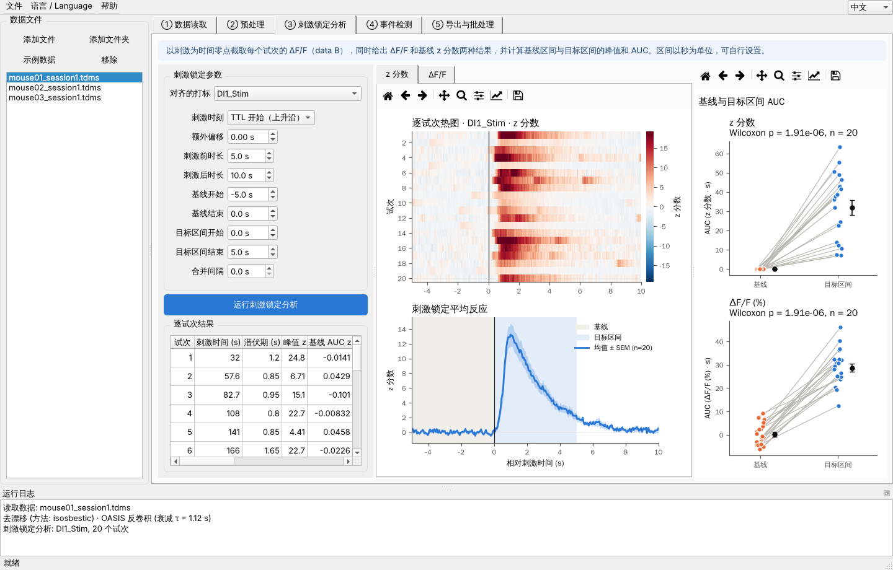

# FiberLume · 光纤荧光分析


### ΔF/F 来源和荧光指示器

Plexon 的 `Frame,time,RawF_1,F0_1,R_1` 以及按波长和光纤编号的导出均可直接读取。默认使用与所选 RawF 同组、同波长的 R 列作为 ΔF/F，保留逐帧原始比值和时间戳。0.03 表示 3%。F0 作为设备基线保留。进入“预处理”，取消“优先使用 Plexon 的 R 列”，重新运行即可从 RawF 拟合基线。未提供匹配 R 列时自动走原始荧光流程。导出摘要记录实际使用的方法和单位。

读取时可在“荧光指示器”中指定探针。留空时优先采用文件的指示器标注，无标注时按 GCaMP 荧光强度解释。摘要分别标记用户指定、文件标注、通道名和默认推定。

### 支持的记录格式

| 设备或格式 | 导入方法 |
|---|---|
| NI TDMS | 选择主记录，外置事件 TDMS 可自动配对。 |
| Plexon Multi-Wavelength / Dual-Wavelength | 在采集软件中导出合并波长的 **PhotoData CSV**，在通道组中选择光纤 F1、F2 等。读取 RawF 原始荧光；Stim 列记录光源状态。独立行为 TTL 表可在打标文件栏选择。单波长导出只含该波长；双波长校正请使用合并表。 |
| Neurophotometrics | 选择带 Timestamp、LedState 或 Flags 和 Region/Channel 编号列的 CSV；按 ROI 和激发波长拆帧。参考轨迹按时间插值，只保留两路共同覆盖的信号帧。 |
| Doric Neuroscience Studio | 打开 .doric 文件，在对应 Series 中选择 AnalogIn 或 Lock-In 解调通道。信号和参考的对应关系按实验接线指定。 |

CSV 默认使用秒，显式标注 `Timestamp (ms)` 或 `Timestamp (us)` 时自动换算。文件夹扫描按表头识别记录；每次分析一个选定的光纤或 Series；同一文件导出多个通道组时，分别选择输出目录，以保留每一组结果。Plexon 此入口用于光纤软件导出的荧光表，PLX/PL2 属于另一种采集格式。

[厂商导出说明（Plexon）](https://plexon.com/wp-content/uploads/2022/05/Multiwavelength-Photometry-Release-Notes.pdf) · [Doric 官方示例](https://github.com/doriclenses/readDoric) · [Neurophotometrics 采集手册](https://neurophotometrics.com/s/Full-Length-Manual-2021.pdf)

Fiber photometry (calcium imaging) analysis for photometry recordings: a batch-processing
core plus a bilingual (Chinese/English) desktop app for users without programming experience.

钙成像光纤记录分析软件：批处理核心 + 中英双语桌面界面，面向没有编程基础的使用者。

## 0.6.0 安装版 / Installation

[Windows x64 安装程序](https://github.com/zjm199502/Fiberphotometry/releases/download/v0.6.0/FiberLume-0.6.0-Windows-Setup.exe) · [macOS Apple silicon 安装镜像](https://github.com/zjm199502/Fiberphotometry/releases/download/v0.6.0/FiberLume-0.6.0-macOS-AppleSilicon.dmg)

从 0.5.0 或更早版本升级，请先下载安装版。Windows 双击 Setup 覆盖安装，macOS 打开 DMG，将 FiberLume 拖入 Applications。两个安装包都包含 Python 和分析依赖。

从 0.6.0 开始，打开“帮助 → 检查更新”可查询正式通道。有兼容补丁时，确认下载后，软件会核验 SHA-256 并保存补丁。可立即重启，也可在下次启动时生效。需要更换基础版本时，菜单会引导用户下载完整安装包。

在“数据读取”页，Plexon 钙信号可选择 `RawF_1`（原始荧光）或 `R_1`（设备 ΔF/F），对照通道可选 `F0_1`（设备基线）。选好后点击“读取”刷新预览。切换预览不会改变预处理页的 ΔF/F 来源设置。

在预览图内按住左键或中键拖动可平移，按住右键拖动可围绕按下的位置缩放。向右拖放大横轴，向上拖放大纵轴。滚轮围绕指针缩放，在坐标轴刻度处操作只改变该轴。工具栏的主页按钮可恢复全图。

## 从源码启动 / Run from source

```bash
pip install -e .[gui]
fiberphoto-gui            # 或 python -m fiberphoto.gui ；加 --en 以英文启动
```

界面按分析步骤分为 5 个标签页：① 数据读取 → ② 预处理 → ③ 刺激锁定分析 → ④ 事件检测 → ⑤ 导出与批处理。
每一步都可以单独运行并立即看到图表（可缩放、平移、保存），参数旁边有悬停说明。右上角随时切换中文/English，
图表语言同步切换。左侧“示例数据”按钮会在“文档/fiberphoto_sample_data”生成培训用数据。
参数可通过“文件 → 保存参数”存成 JSON，供全组共用。

新生图文操作手册：[docs/manual/用户手册.md](docs/manual/用户手册.md)（PDF：`docs/manual/manual_zh.pdf`），
English: [docs/manual/User_Manual.md](docs/manual/User_Manual.md)。软件内“帮助 → 用户手册”可直接打开 PDF。
修改手册后运行 `python docs/manual/build_pdf.py <chromium>` 重新生成 PDF。



### 打包成可执行文件 / Building the app

```bash
pip install -e .[gui] pyinstaller
pyinstaller packaging/fiberphoto.spec --noconfirm   # → dist/fiberphoto/ （macOS 为 dist/fiberphoto.app）
```

PyInstaller 只能在目标系统上打包（Windows 版要在 Windows 上打包）。仓库放到 GitHub 后，
`.github/workflows/build.yml` 会在推送 `v*` 标签或手动触发时自动打包 Windows 和 macOS 两个版本。

## 流程 / Pipeline

| 阶段 Stage | 模块 Module | 输入 → 输出 |
|---|---|---|
| 数据读取 Read | `recordings.py`、`io_tdms.py` | 原始光纤记录 → **data A**（信号、对照通道、行为打标） |
| 去漂移 De-drift | `preprocess.dedrift` | data A → **data B**（ΔF/F，备份） |
| 反卷积 Deconvolve | `preprocess.deconvolve` (OASIS) | data B → **data C**（去噪信号 + 推断活动，备份） |
| 刺激锁定 Peri-event | `analysis.peri_event` | data B + 打标 → 逐试次矩阵、AUC、峰值、潜伏期 |
| 事件检测 Events | `analysis.detect_events` | data C → 事件表、频率、幅度、间隔 |
| 图表 Figures | `plotting.py` | 原始信号、去漂移、反卷积、热图 + PETH、AUC、事件分布、刺激前后频率 |

**通道识别**: 根据通道名自动猜测（470/465 → 信号，405/410 → 对照，TTL/DI/Stim → 打标），
也可以手动指定。打标可以来自 TDMS 的数字通道（自动检测上升沿），也可以来自 CSV/Excel 表格
（列名 onset/offset/label）。

**去漂移方法**: `isosbestic`（405 对照通道稳健回归拟合，默认），`biexponential`（无对照时自动使用），
`polynomial`，`highpass`。

## 安装 / Install

```bash
pip install -e .            # Python ≥ 3.10
```

## 使用 / Usage

```bash
fiberphoto sample examples/sample_data          # 生成示例数据（3 只小鼠）
fiberphoto inspect examples/sample_data/mouse01_session1.tdms   # 查看通道
fiberphoto config params.json                   # 导出默认参数，可编辑
fiberphoto run examples/sample_data -o results -c params.json --lang zh
```

Python:

```python
from fiberphoto import PipelineConfig, run_file
cfg = PipelineConfig()
cfg.peth.pre_s, cfg.peth.post_s = 5, 10
res = run_file("mouse01_session1.tdms", cfg, "results", log=print)
res.peth.metrics, res.events.summary
```

## 输出 / Outputs (per recording)

```
results/<文件名>/
  <文件名>.h5                 data A / B / C 备份（HDF5）
  <文件名>_dataA.csv, _dataB.csv, _dataC.csv, _dataA_markers.csv
  peth_trials.csv            逐试次刺激锁定曲线 + 均值、SEM
  peth_metrics.csv           每个试次的 AUC、峰值、潜伏期
  events.csv                 每个事件的时间、幅度、半宽、间隔
  events_vs_stimulus.csv     每次刺激前后的事件数和频率
  summary.json               汇总指标
  parameters.json            本次使用的全部参数（可复现）
  figures/                   PNG + PDF（PDF 文字可在 Illustrator 中编辑）
results/batch_summary.csv    所有文件的汇总表
```

## 示例数据 / Sample data

`examples/sample_data/` 中的三份合成记录模拟 470/405 双通道、光漂白、运动伪迹、自发钙事件和
刺激诱发反应（mouse01 强反应，mouse02 中等，mouse03 几乎无反应）。每份数据附带
`_ground_truth.json`（真实事件时间），便于培训时核对分析结果。

## 测试 / Tests

```bash
pip install -e .[gui,test] && QT_QPA_PLATFORM=offscreen pytest
```
