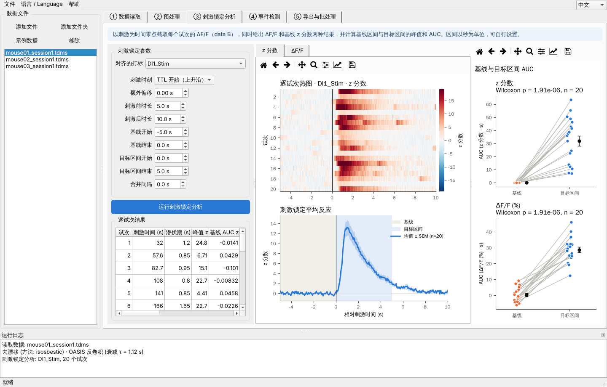

# fiberphoto · 光纤记录钙成像分析

Fiber photometry (calcium imaging) analysis for TDMS recordings: a batch-processing
core plus a bilingual (Chinese/English) desktop app for users without programming experience.

钙成像光纤记录（TDMS 格式）分析软件：批处理核心 + 中英双语桌面界面，面向没有编程基础的使用者。

## 图形界面 / Desktop app

```bash
pip install -e .[gui]
fiberphoto-gui            # 或 python -m fiberphoto.gui ；加 --en 以英文启动
```

界面按分析步骤分为 5 个标签页：① 数据读取 → ② 预处理 → ③ 刺激锁定分析 → ④ 事件检测 → ⑤ 导出与批处理。
每一步都可以单独运行并立即看到图表（可缩放、平移、保存），参数旁边有悬停说明。右上角随时切换中文/English，
图表语言同步切换。左侧“示例数据”按钮会在“文档/fiberphoto_sample_data”生成培训用数据。
参数可通过“文件 → 保存参数”存成 JSON，供全组共用。

新生图文操作手册：[docs/manual/用户手册.md](docs/manual/用户手册.md)（PDF：`docs/manual/manual_zh.pdf`），
English: [docs/manual/User_Manual.md](docs/manual/User_Manual.md)。软件内“帮助 → 用户手册”可直接打开 PDF。
修改手册后运行 `python docs/manual/build_pdf.py <chromium>` 重新生成 PDF。



### 打包成可执行文件 / Building the app

```bash
pip install -e .[gui] pyinstaller
pyinstaller packaging/fiberphoto.spec --noconfirm   # → dist/fiberphoto/ （macOS 为 dist/fiberphoto.app）
```

PyInstaller 只能在目标系统上打包（Windows 版要在 Windows 上打包）。仓库放到 GitHub 后，
`.github/workflows/build.yml` 会在推送 `v*` 标签或手动触发时自动打包 Windows 和 macOS 两个版本。

## 流程 / Pipeline

| 阶段 Stage | 模块 Module | 输入 → 输出 |
|---|---|---|
| 数据读取 Read | `io_tdms.py` | TDMS → **data A**（信号、对照通道、行为打标） |
| 去漂移 De-drift | `preprocess.dedrift` | data A → **data B**（ΔF/F，备份） |
| 反卷积 Deconvolve | `preprocess.deconvolve` (OASIS) | data B → **data C**（去噪信号 + 推断活动，备份） |
| 刺激锁定 Peri-event | `analysis.peri_event` | data B + 打标 → 逐试次矩阵、AUC、峰值、潜伏期 |
| 事件检测 Events | `analysis.detect_events` | data C → 事件表、频率、幅度、间隔 |
| 图表 Figures | `plotting.py` | 原始信号、去漂移、反卷积、热图 + PETH、AUC、事件分布、刺激前后频率 |

**通道识别**: 根据通道名自动猜测（470/465 → 信号，405/410 → 对照，TTL/DI/Stim → 打标），
也可以手动指定。打标可以来自 TDMS 的数字通道（自动检测上升沿），也可以来自 CSV/Excel 表格
（列名 onset/offset/label）。

**去漂移方法**: `isosbestic`（405 对照通道稳健回归拟合，默认），`biexponential`（无对照时自动使用），
`polynomial`，`highpass`。

## 安装 / Install

```bash
pip install -e .            # Python ≥ 3.10
```

## 使用 / Usage

```bash
fiberphoto sample examples/sample_data          # 生成示例数据（3 只小鼠）
fiberphoto inspect examples/sample_data/mouse01_session1.tdms   # 查看通道
fiberphoto config params.json                   # 导出默认参数，可编辑
fiberphoto run examples/sample_data -o results -c params.json --lang zh
```

Python:

```python
from fiberphoto import PipelineConfig, run_file
cfg = PipelineConfig()
cfg.peth.pre_s, cfg.peth.post_s = 5, 10
res = run_file("mouse01_session1.tdms", cfg, "results", log=print)
res.peth.metrics, res.events.summary
```

## 输出 / Outputs (per recording)

```
results/<文件名>/
  <文件名>.h5                 data A / B / C 备份（HDF5）
  <文件名>_dataA.csv, _dataB.csv, _dataC.csv, _dataA_markers.csv
  peth_trials.csv            逐试次刺激锁定曲线 + 均值、SEM
  peth_metrics.csv           每个试次的 AUC、峰值、潜伏期
  events.csv                 每个事件的时间、幅度、半宽、间隔
  events_vs_stimulus.csv     每次刺激前后的事件数和频率
  summary.json               汇总指标
  parameters.json            本次使用的全部参数（可复现）
  figures/                   PNG + PDF（PDF 文字可在 Illustrator 中编辑）
results/batch_summary.csv    所有文件的汇总表
```

## 示例数据 / Sample data

`examples/sample_data/` 中的三份合成记录模拟 470/405 双通道、光漂白、运动伪迹、自发钙事件和
刺激诱发反应（mouse01 强反应，mouse02 中等，mouse03 几乎无反应）。每份数据附带
`_ground_truth.json`（真实事件时间），便于培训时核对分析结果。

## 测试 / Tests

```bash
pip install -e .[gui,test] && QT_QPA_PLATFORM=offscreen pytest
```
