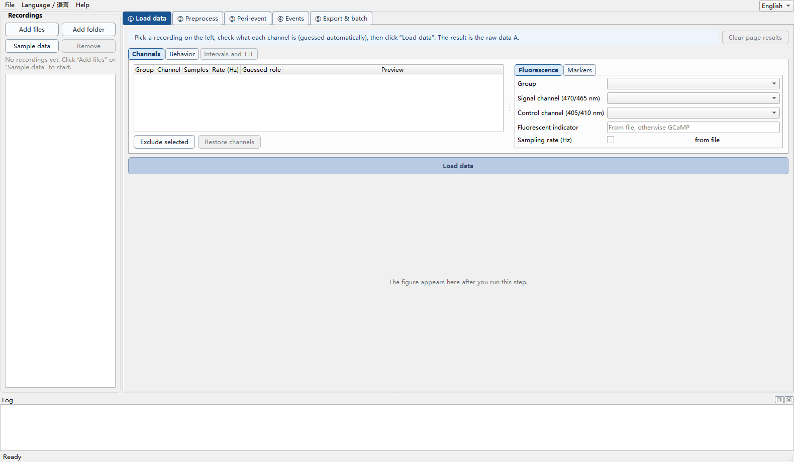
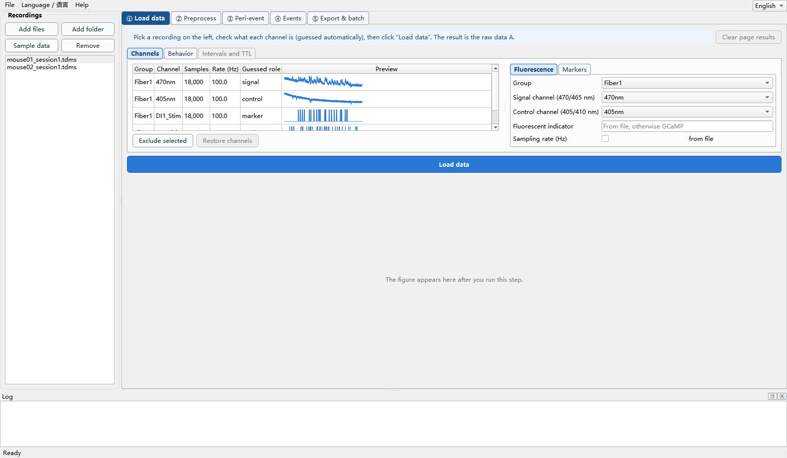
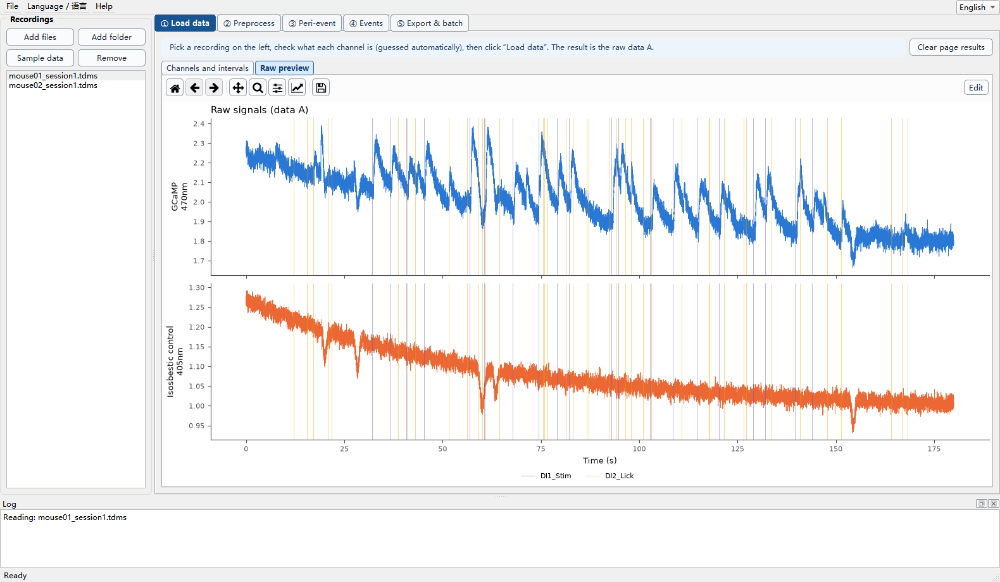
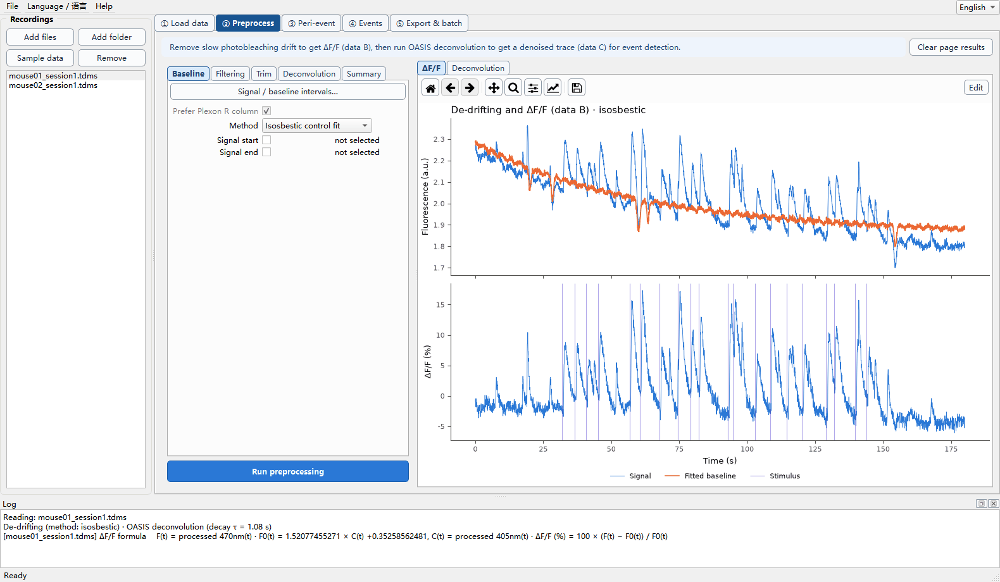
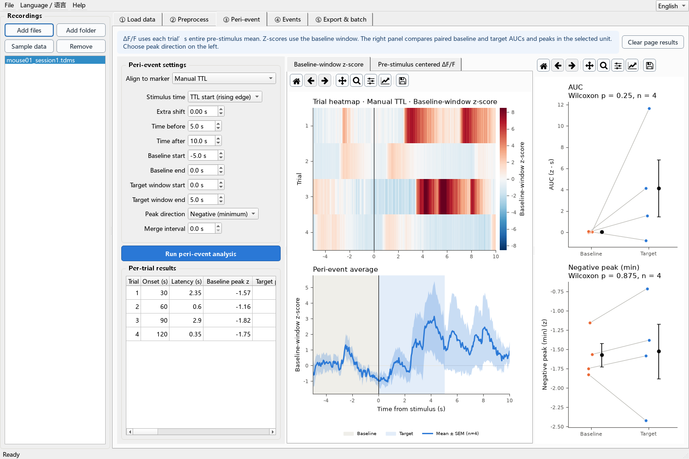
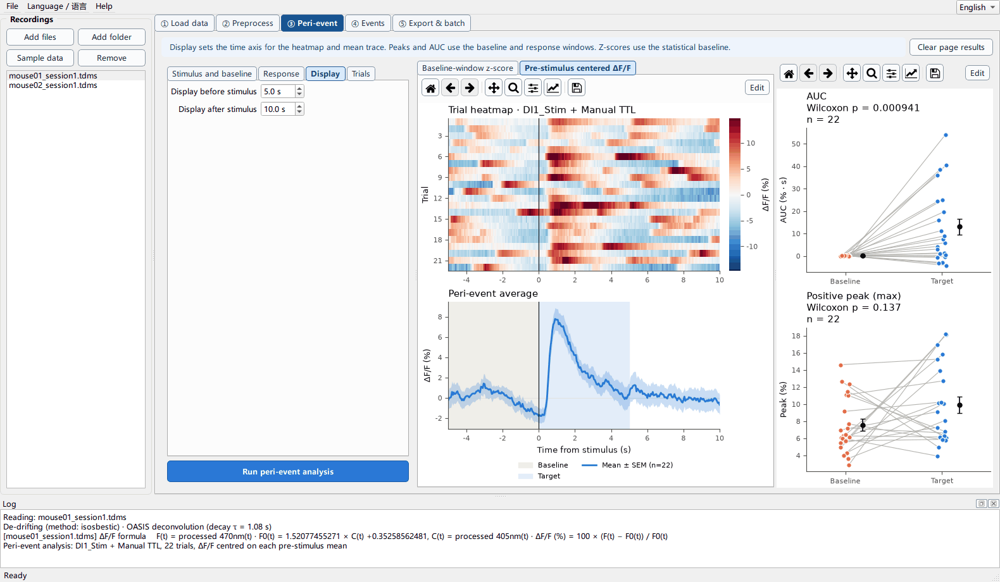
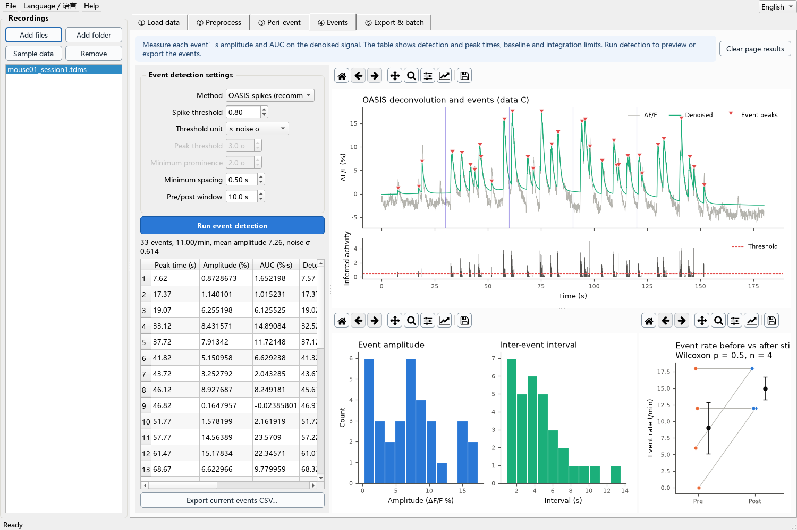
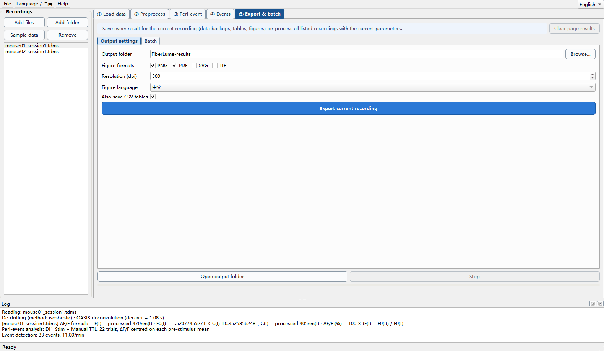

# FiberLume Fiber Photometry Analysis · Manual for New Students

> Version 0.6.5. Working through the sample data takes about 15 minutes.

## Contents

1. What the software does
2. Installing and starting
3. The interface
4. Quick start with the sample data
5. Analysing your own data
6. Key parameters
7. Output files
8. FAQ

---

## 1. What the software does

FiberLume divides the analysis into five pages. Each page provides controls for changing parameters and reviewing the results.

| Step | What it does | Result |
|---|---|---|
| ① Load data | Reads a TDMS file and finds the calcium signal channel (470/465 nm), the isosbestic control (405/410 nm) and the behaviour markers (TTL) | **data A** (raw data) |
| ② Preprocess | Removes the slow drift caused by photobleaching and computes ΔF/F, then runs OASIS deconvolution to get a denoised trace and inferred spikes | **data B** (ΔF/F), **data C** (deconvolution) |
| ③ Peri-event | Aligns trials to each stimulus and compares baseline and response windows | Heatmaps, mean traces and paired AUC and peak plots |
| ④ Events | Following OASIS, treats spikes as calcium events; reports rate, amplitude and interval, and compares before vs after stimuli | event table and distributions |
| ⑤ Export & batch | Saves all data backups, tables and figures, or processes a whole folder with the same parameters | results folder |

Each page has a button for clearing its results. For example, clear the peri-event results to try a different window while retaining the event detection results. Clearing preprocessing also clears the analyses that use its output. Your parameters, source recordings and previously exported files are preserved.

## 2. Installing and starting

### Windows

Run `FiberLume-0.6.0-Windows-Setup.exe`, complete the installation and open **FiberLume** from the Start menu.

### macOS

On an Apple silicon Mac, open `FiberLume-0.6.0-macOS-AppleSilicon.dmg`, drag **FiberLume** to Applications and launch it.

After installing, open **Help → Check for updates**, download the patch and restart the app. The installer includes Python and the analysis dependencies.

## 3. The interface

- **Recordings (left)**: add files, add a folder, load the sample data, remove. Click a file in the list to make it the current recording.
- **Five tabs (centre)**: the analysis order, left to right. The blue banner at the top of each tab explains the step.
- **Parameter boxes**: hover over any parameter for an explanation. Parameters are shared by all files.
- **Figure toolbar**: 🏠 reset, ✥ pan, 🔍 zoom, 💾 save the figure.
- **Log (bottom)**: what each step did and any warnings. When something goes wrong, send a screenshot of the log to a senior lab member.
- **Language switch (top right)**: 中文 / English at any time; exported figures follow the language.
- **File menu**: save, load or reset parameters. Save one parameter file per experiment so you can check them when writing up.

## 4. Quick start with the sample data

The sample data are three simulated mice (mouse01–03), 10 minutes each with 20 stimuli, from strong to weak responses. Because they are simulated, the “right answer” is known, which makes them good for practice.

### Step 1: load the sample data

Click **Sample data** on the left. The app creates a `fiberphoto_sample_data` folder in Documents and adds the files to the list.

### Step 2: ① Load data

1. Select `mouse01_session1.tdms` on the left.
2. The table lists every channel in the file. The **Preview thumbnails** help you tell channels apart: the calcium signal has many small peaks, the control channel is smoother, and marker channels are square pulses.
3. Under channel settings on the right the app has already guessed the signal, control and marker channels. Check them, then click **Load data**.

In the figure, blue is the calcium signal, orange is the control and the vertical lines are markers. After reading, “Markers: DI1_Stim (20) …” shows how many markers were found on each channel.

To annotate a known stimulus time, click **Add TTL points**, then click the waveform preview. Each mark snaps to the nearest recorded frame. Continue marking, undo the latest point, or press Esc to finish. Select **Manual TTL** as the marker in the Peri-event tab. Save parameters to retain the annotations for this recording.

### Step 3: ② Preprocess

Open **② Preprocess** and click **Run preprocessing** (the defaults are fine).

- The upper right panel shows the signal, its baseline and the resulting data B. When a loaded Plexon signal has a matching R column, select the device ratio or uncheck it to recompute from raw fluorescence. Other recording formats use their own preprocessing settings.
- Bottom right: grey is ΔF/F, green is the OASIS denoised trace, and the small panel shows the inferred spikes (data C). τ in the title is the calcium decay time constant, typically 0.5–2 s for GCaMP6s.

### Step 4: ③ Peri-event

Open **③ Peri-event** and click **Run peri-event analysis**.

- **Heatmap**: one row per trial; 0 s (black line) is the stimulus.
- **Mean trace**: the grey band is the **baseline window**, the light blue band is the **target window**, and the line with shading is mean ± SEM.
- The **paired comparisons** on the right show AUC and peak in the baseline and response windows. Each line connects measurements from the same trial in the selected Z or ΔF/F view. Positive peaks use the maximum of each window. Negative peaks use the signed minimum. Response latency is the time of the first extremum in the selected direction.
- **Trial table**: latency, peak, AUC and more for each trial. Scroll sideways to see all columns.

Click the **ΔF/F** tab above the figure to see the same analysis in ΔF/F:

### Step 5: ④ Events

Open **④ Events** and click **Run event detection**.

- Red triangles mark detected events; the red dashed line in the small panel is the spike threshold (default 0.8 × noise σ).
- The three lower figures show the amplitude distribution, the interval distribution and the event rate before vs after stimuli.
- The event table lists peak time, amplitude, AUC, detection time, integration limits and baseline. Click **Export current events CSV** to save the displayed run. Amplitude is the height of the denoised peak above the event baseline. The signed AUC integrates the denoised trace relative to the same baseline using the sample timestamps, in trace units × seconds.

### Step 6: ⑤ Export & batch

Open **⑤ Export & batch**:

1. Choose an **Output folder**.
2. Tick the figure formats (PNG for slides, PDF/SVG for editing in Illustrator). Resolution defaults to 300 dpi.
3. **Export current recording** saves only the current file; **Process all recordings** runs every file in the list with the current parameters.
4. Click **Open output folder** to see the results.

> Well done, that is a complete analysis. Try mouse03 (the weakest responder) and compare.

## 5. Analysing your own data

### 5.1 Preparing files

- Put all `.tdms` files from one experiment in one folder.
- If markers were saved separately as `xxx-Event.tdms`, give it the **same name in the same folder** as the main file, e.g. `mouse01.tdms` and `mouse01-Event.tdms`. The app pairs them automatically and does not list the Event file as a separate recording.
- Markers can also come from a CSV/Excel table: click **Browse…** next to “Marker file”. Each row is one marker, with an `onset` column (seconds), an optional `offset` column and an optional `label` column (e.g. tone, shock).
- Avoid special symbols in file paths.

#### ABET cue and tray sessions

Place each calcium recording next to its same-stem ABET XML, for example `mouse01.csv` and `mouse01.xml`. Open the ABET XML in Load data and inspect trials, cue, tray light, accepted tray entry and feeder commands. The feeder timestamp records the command sent by the task. Measuring consumption requires a separate observation.

Choose a clock mapping for each recording. One measured pulse on both clocks gives an offset. Two corresponding rising edges also estimate relative clock rate. For rigs where the first `start #1` pulse starts acquisition, explicitly selecting the assumed-trigger mode places the pulse at first-frame time minus the assumed startup latency (default zero). The span difference between the first/last frames and the start/end pulses can include other effects such as a stop delay or clock drift. Behavior-only mode allows trial inspection and export while synchronization is pending.

After preprocessing choose **Compare ABET cue and tray groups** in the peri-event tab. Standard cues are grouped by subsequent accepted response or timeout. Unusual simultaneous light and tone trials are reported separately. Each waveform is centered on its preceding 3 seconds; the mean, signed AUC and selected peak direction use 0 to 3 seconds. Compare the combined accepted tray entry and feeder command with isolated out-of-window tray entries. These session-level summaries preserve trial IDs and exclusions. Account for repeated trials within animals in downstream inference.

Batch export takes per-recording settings or a synchronization manifest. Look under each session's `abet` directory for trials and clock information and under `locked` for mapped event metrics, traces and group summaries. Check the sync mode before pooling sessions.

On the export tab use **Export manifest template** to write one row per recording, including any previously set anchors. Set `recording`, the optional `xml` path and `mode`. Choose `behavior_only` for native seconds or `disabled` to skip the association. For `assumed_trigger`, supply `latency_s` (zero for an unknown delay). For `offset`, enter the matching `abet_1_s` and `calcium_1_s`. For `affine`, also fill in `abet_2_s` and `calcium_2_s` for a later matched event. Load the manifest on the same tab, then run the batch. The root `batch_abet_groups.csv` includes per-session sample counts, sync modes, units and group means.

### 5.2 Three things to check when reading

For batch timing checks, `batch_summary.csv` lists recording and pulse spans separately. With measured anchors and two boundary pulses, `abet_first_frame_minus_mapped_start_s` and `abet_last_frame_minus_mapped_end_s` give the signed time of the corresponding frame relative to the mapped pulse. A positive value means the frame came later. These columns stay blank for behavior-only and assumed-trigger sessions.

1. **Sampling rate**: our lab records at **50 Hz**. If the file does not store its sampling rate, an orange note appears; enter `50` under **Sampling rate (Hz)**. “from file” means the rate stored in the file is used.
2. **Channels**: use the Preview thumbnails to confirm the signal and control channels. If the guess is wrong, change it in the drop-down lists.
3. **Marker count**: after reading, check that the count in “Markers: … (n)” matches the number of stimuli actually given.

### 5.3 Shock experiments: align to the TTL end

The shock software first sends a **1 s** TTL and delivers the shock **when the TTL ends**. In ③ Peri-event:

- set **Stimulus time** to **TTL end (falling edge)**;
- leave **Extra shift** at 0.

For stimuli that start with the TTL (tones, light), use **TTL start (rising edge)**.

### 5.4 LED-off start

Many recordings begin with a few seconds before the LED is on, where the signal is near zero. **Auto-trim LED-off start** (on by default) removes that part and notes it in the log. To remove more (for example an unstable first minute), enter seconds under **Trim start / Trim end**.

### 5.5 Preprocessing warnings

Log lines starting with ⚠ (for example “Baseline fluorescence is zero or negative” or “No control channel”) mean the data may have a problem: wrong channel, a disconnected control, a loose fiber. Check the raw figure in ① and discuss with a senior lab member whether to keep the animal. “Light source off … trimmed automatically” is only a note.

## 6. Key parameters

Every parameter has a hover tip. These are the ones you are most likely to change; **leave the rest at their defaults**.

### Preprocessing

| Parameter | Default | Meaning |
|---|---|---|
| Method | Isosbestic control fit | Fits the 405 nm control and removes drift and motion artefacts. Without a control channel the app falls back to a biexponential fit. |
| Low-pass filter | 10 Hz | Removes high-frequency noise; affects data B display and the peri-event analysis only. |
| Downsample to | 20 Hz | Smaller files. Going from 50 to 20 Hz does not affect calcium signals. |
| Output unit | ΔF/F (%) | Applies to recomputed fluorescence. Direct Plexon R imports keep the device ratio. |
| Calcium model | AR(1) | AR(1) when the indicator rises quickly; try AR(2) for slower rises. |

Deconvolution uses the **de-drifted ΔF/F (data B, before low-pass)**, not the raw data.

### Peri-event

| Parameter | Default | Meaning |
|---|---|---|
| Stimulus time | TTL start | Use **TTL end** for shock experiments (see 5.3). |
| Time before / after | 5 s / 10 s | The window cut for each trial (heatmap x-axis). |
| Baseline start / end | −5 s / 0 s | Sets the window for z-scores and baseline AUC. ΔF/F centring uses the full pre-stimulus duration. |
| Target window start / end | 0 s / 5 s | Window for the target AUC and the peak. |
| Peak direction | Positive | Select positive for increases and negative for decreases. Both windows and the response latency use this direction. |
| Merge interval | 0 s | Markers closer than this count as one (removes duplicate markers). |

All times are in seconds relative to the stimulus; negative means before.

Each **centred ΔF/F** trial is ΔF/F(t) − m, where m is the mean of all pre-stimulus samples (t < 0) in that trial. The sample at stimulus time zero is excluded. The heatmap, average, ΔF/F peak and AUC all use this centred trace in the original data B units. The value subtracted from each trial is recorded in the `prestimulus_mean_input_dff` column of `peth_metrics.csv`. Z-scores use the configured baseline window’s mean and sample standard deviation. AUC uses trapezoidal integration.

### Events

| Parameter | Default | Meaning |
|---|---|---|
| Method | OASIS spikes | Following OASIS, inferred spikes are calcium events. |
| Spike threshold | 0.80 | Used together with the threshold unit. |
| Threshold unit | × noise σ | A spike ≥ 0.8 × noise SD is an event. Higher → fewer, more reliable events; lower → more sensitive but more false positives. |
| Minimum spacing | 0.5 s | Spikes closer than this merge into one event. |
| Pre/post window | 10 s | Event rate compared in the 10 s before vs after each stimulus. |

> **Use the same parameters for every animal in an experiment.** Save them with File → Save parameters, and load the same file for batch runs.

## 7. Output files

Each recording gets its own sub-folder in the output folder:

| File | Contents |
|---|---|
| `<name>.h5` | Full backup of data A / B / C (HDF5), readable in Python/MATLAB |
| `<name>_dataA.csv` / `_dataB.csv` / `_dataC.csv` | The same as tables, open in Excel |
| `peth_trials_z.csv` / `peth_trials_dff.csv` | Z-score and pre-stimulus-centred ΔF/F traces. Rows are relative times, with one column per trial plus mean and SEM. |
| `peth_metrics.csv` | Per-trial latency, baseline/target means, peak, AUC (for both z and ΔF/F) |
| `events.csv` | Per-event times, amplitude, AUC, integration bounds, baseline, units and detector-specific measurements. |
| `peth_paired_stats.csv` | Paired baseline and response AUC and peak comparisons with direction, units, sample counts, means and p-values. |
| `events_vs_stimulus.csv` | Events and rate before/after each stimulus |
| `summary.json` | Summary metrics for the recording |
| `parameters.json` | All parameters used (load it in the app to reproduce) |
| `figures/` | 01 raw, 02 de-drift, 03 deconvolution and events, 04 heatmaps (Z / ΔF/F), 05 paired AUC and peak comparisons, 06 event distributions, 07 event rate pre/post |

A batch run also writes `batch_summary.csv` at the top of the output folder, one row per animal, ready for group statistics.

## 8. FAQ

**Q: “Load data” asks for a sampling rate.**
A: The file does not store one. Enter 50 under “Sampling rate (Hz)” in ① and read again.

**Q: The marker count is 0 or wrong.**
A: Check that the marker channel’s preview shows square pulses. If markers are in a separate `-Event.tdms` file, make sure it has the same name and folder as the main file, or choose it under “Marker file”.

**Q: ΔF/F tilts or jumps.**
A: Possibly a loose fiber or a bad control channel. Try “Biexponential” as the method and compare. If the jump is only at the start or end, trim it with “Trim start / Trim end”.

**Q: Too many / too few events.**
A: Change “Spike threshold”. Get a feel for it on the sample data first, then choose one value for all your animals.

**Q: Peri-event analysis says there are no markers.**
A: Check that “Align to marker” is set to the right marker channel.

**Q: The app seems frozen.**
A: Long files take time; the progress bar and log keep updating. Click “Stop” in ⑤ to interrupt. If it truly does not respond, restart the app and send a screenshot of the log to the maintainer.

**Q: Can I continue on another computer?**
A: Copy the output folder together with `parameters.json`. The h5 backups can be opened directly without recomputing.

---

If something goes wrong, read the log first, then contact the lab’s software maintainer.
