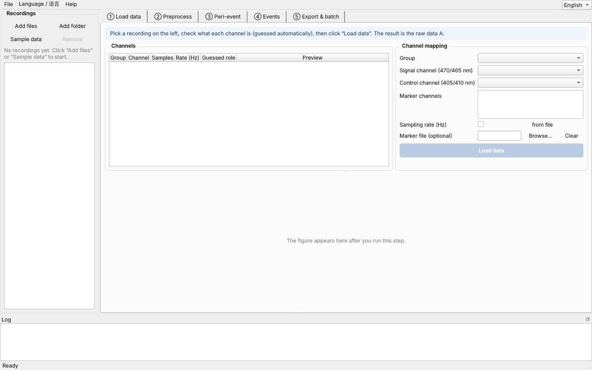
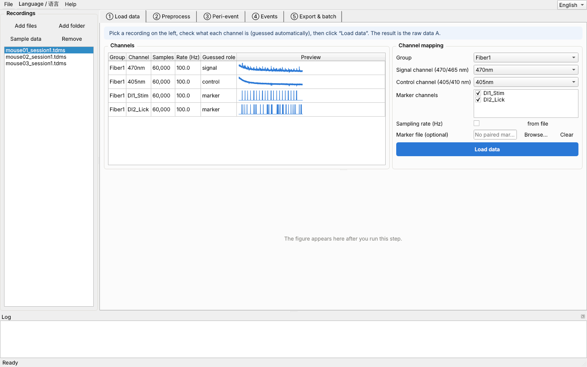
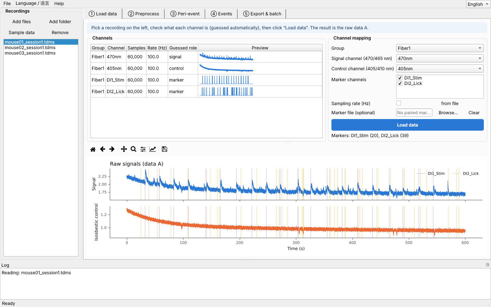
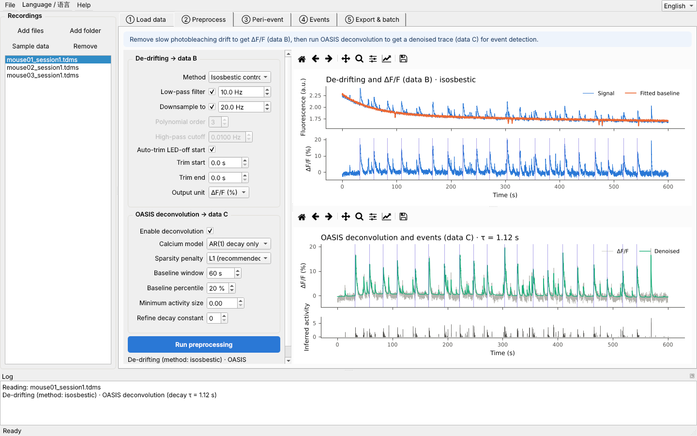
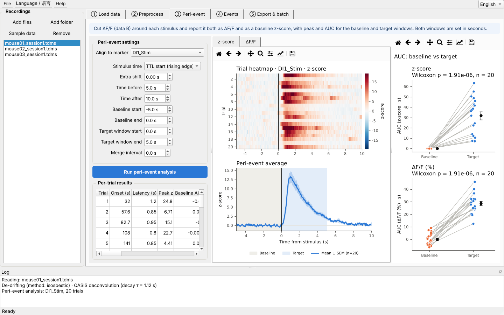
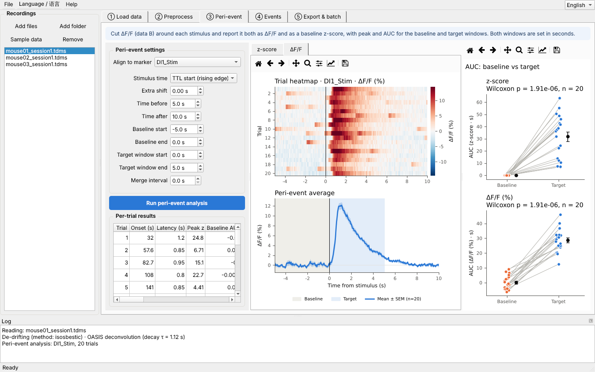
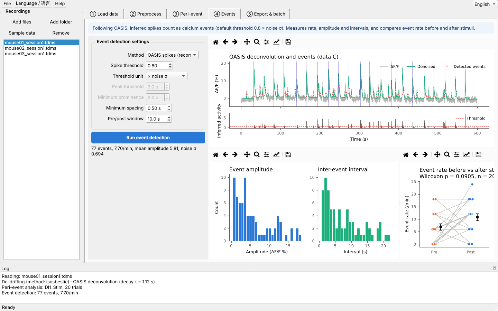
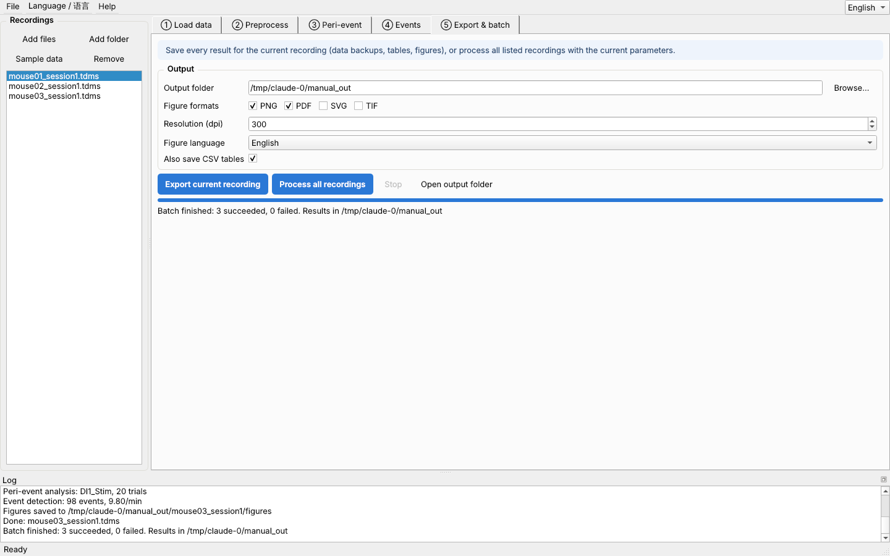

# FiberPhoto Fiber Photometry Analysis · Manual for New Students

> Version 0.3 · Written for students with no programming background. Working through the sample data takes about 15 minutes.

## Contents

1. What the software does
2. Installing and starting
3. The interface
4. Quick start with the sample data
5. Analysing your own data
6. Key parameters
7. Output files
8. FAQ

---

## 1. What the software does

FiberPhoto turns the lab's fiber photometry analysis (calcium imaging, TDMS files) into five tabs that you work through in order. Every step shows its figures and lets you change its parameters.

| Step | What it does | Result |
|---|---|---|
| ① Load data | Reads a TDMS file and finds the calcium signal channel (470/465 nm), the isosbestic control (405/410 nm) and the behaviour markers (TTL) | **data A** (raw data) |
| ② Preprocess | Removes the slow drift caused by photobleaching and computes ΔF/F, then runs OASIS deconvolution to get a denoised trace and inferred spikes | **data B** (ΔF/F), **data C** (deconvolution) |
| ③ Peri-event | Cuts a trial around every stimulus and reports z-score, ΔF/F and AUC together | heatmaps, mean trace, paired AUC plot |
| ④ Events | Following OASIS, treats spikes as calcium events; reports rate, amplitude and interval, and compares before vs after stimuli | event table and distributions |
| ⑤ Export & batch | Saves all data backups, tables and figures, or processes a whole folder with the same parameters | results folder |

data B and data C are always saved as backups (HDF5 + CSV), so you never need to recompute them.

## 2. Installing and starting

### Windows

1. Double-click `FiberPhoto-0.3.1-Windows-Setup.exe`.
2. If “Windows protected your PC” appears, click **More info → Run anyway**. The app is not commercially signed; it is not a virus.
3. Click **Next** through the installer (no administrator rights needed); tick “Create a desktop shortcut” if you like.
4. Open **FiberPhoto** from the Start menu or desktop. The Start menu also has shortcuts to the manual. To uninstall: Settings → Apps → FiberPhoto → Uninstall.

### macOS

The installer is `FiberPhoto-0.3.1-macOS-AppleSilicon.dmg`, for Macs with Apple M-series chips (M1/M2/M3/M4;  menu → About This Mac → “Chip”). Intel Macs are not supported.

1. Double-click the dmg and drag **FiberPhoto** onto the **Applications** folder in the window that opens.
2. The first time, double-click FiberPhoto in Applications. If macOS says it cannot verify the developer, click **Done/Cancel**, open **System Settings → Privacy & Security**, click **Open Anyway** near the bottom and confirm with your password. After that it opens normally.
3. If macOS says the app “is damaged and can’t be opened”, open Terminal, run the line below, and open the app again:
   `xattr -cr /Applications/FiberPhoto.app`

> The installer contains everything the app needs; **you do not need to install Python or any libraries**.
>
> The app takes a few seconds to start. Please do not double-click it repeatedly.

## 3. The interface

- **Recordings (left)**: add files, add a folder, load the sample data, remove. Click a file in the list to make it the current recording.
- **Five tabs (centre)**: the analysis order, left to right. The blue banner at the top of each tab explains the step.
- **Parameter boxes**: hover over any parameter for an explanation. Parameters are shared by all files.
- **Figure toolbar**: 🏠 reset, ✥ pan, 🔍 zoom, 💾 save the figure.
- **Log (bottom)**: what each step did and any warnings. When something goes wrong, send a screenshot of the log to a senior lab member.
- **Language switch (top right)**: 中文 / English at any time; exported figures follow the language.
- **File menu**: save, load or reset parameters. Save one parameter file per experiment so you can check them when writing up.

## 4. Quick start with the sample data

The sample data are three simulated mice (mouse01–03), 10 minutes each with 20 stimuli, from strong to weak responses. Because they are simulated, the “right answer” is known, which makes them good for practice.

### Step 1: load the sample data

Click **Sample data** on the left. The app creates a `fiberphoto_sample_data` folder in Documents and adds the files to the list.

### Step 2: ① Load data

1. Select `mouse01_session1.tdms` on the left.
2. The table lists every channel in the file. The **Preview thumbnails** help you tell channels apart: the calcium signal has many small peaks, the control channel is smoother, and marker channels are square pulses.
3. Under channel settings on the right the app has already guessed the signal, control and marker channels. Check them, then click **Load data**.

In the figure, blue is the calcium signal, orange is the control and the vertical lines are markers. After reading, “Markers: DI1_Stim (20) …” shows how many markers were found on each channel.

### Step 3: ② Preprocess

Open **② Preprocess** and click **Run preprocessing** (the defaults are fine).

- Top right: the signal with its fitted baseline (orange) above, and the de-drifted ΔF/F (data B) below. Once the drift is removed the trace should be roughly flat.
- Bottom right: grey is ΔF/F, green is the OASIS denoised trace, and the small panel shows the inferred spikes (data C). τ in the title is the calcium decay time constant, typically 0.5–2 s for GCaMP6s.

### Step 4: ③ Peri-event

Open **③ Peri-event** and click **Run peri-event analysis**.

- **Heatmap**: one row per trial; 0 s (black line) is the stimulus.
- **Mean trace**: the grey band is the **baseline window**, the light blue band is the **target window**, and the line with shading is mean ± SEM.
- **Paired AUC plot (right)**: each grey line joins a trial’s baseline AUC to its target AUC, with the paired test p-value above. The top panel is z-score, the bottom panel ΔF/F.
- **Trial table**: latency, peak, AUC and more for each trial. Scroll sideways to see all columns.

Click the **ΔF/F** tab above the figure to see the same analysis in ΔF/F:

### Step 5: ④ Events

Open **④ Events** and click **Run event detection**.

- Red triangles mark detected events; the red dashed line in the small panel is the spike threshold (default 0.8 × noise σ).
- The three lower figures show the amplitude distribution, the interval distribution and the event rate before vs after stimuli.
- The left panel shows the number of events, rate (/min), mean amplitude and noise σ.

### Step 6: ⑤ Export & batch

Open **⑤ Export & batch**:

1. Choose an **Output folder**.
2. Tick the figure formats (PNG for slides, PDF/SVG for editing in Illustrator). Resolution defaults to 300 dpi.
3. **Export current recording** saves only the current file; **Process all recordings** runs every file in the list with the current parameters.
4. Click **Open output folder** to see the results.

> Well done, that is a complete analysis. Try mouse03 (the weakest responder) and compare.

## 5. Analysing your own data

### 5.1 Preparing files

- Put all `.tdms` files from one experiment in one folder.
- If markers were saved separately as `xxx-Event.tdms`, give it the **same name in the same folder** as the main file, e.g. `mouse01.tdms` and `mouse01-Event.tdms`. The app pairs them automatically and does not list the Event file as a separate recording.
- Markers can also come from a CSV/Excel table: click **Browse…** next to “Marker file”. Each row is one marker, with an `onset` column (seconds), an optional `offset` column and an optional `label` column (e.g. tone, shock).
- Avoid special symbols in file paths.

### 5.2 Three things to check when reading

1. **Sampling rate**: our lab records at **50 Hz**. If the file does not store its sampling rate, an orange note appears; enter `50` under **Sampling rate (Hz)**. “from file” means the rate stored in the file is used.
2. **Channels**: use the Preview thumbnails to confirm the signal and control channels. If the guess is wrong, change it in the drop-down lists.
3. **Marker count**: after reading, check that the count in “Markers: … (n)” matches the number of stimuli actually given.

### 5.3 Shock experiments: align to the TTL end

The shock software first sends a **1 s** TTL and delivers the shock **when the TTL ends**. In ③ Peri-event:

- set **Stimulus time** to **TTL end (falling edge)**;
- leave **Extra shift** at 0.

For stimuli that start with the TTL (tones, light), use **TTL start (rising edge)**.

### 5.4 LED-off start

Many recordings begin with a few seconds before the LED is on, where the signal is near zero. **Auto-trim LED-off start** (on by default) removes that part and notes it in the log. To remove more (for example an unstable first minute), enter seconds under **Trim start / Trim end**.

### 5.5 Preprocessing warnings

Log lines starting with ⚠ (for example “Baseline fluorescence is zero or negative” or “No control channel”) mean the data may have a problem: wrong channel, a disconnected control, a loose fiber. Check the raw figure in ① and discuss with a senior lab member whether to keep the animal. “Light source off … trimmed automatically” is only a note.

## 6. Key parameters

Every parameter has a hover tip. These are the ones you are most likely to change; **leave the rest at their defaults**.

### Preprocessing

| Parameter | Default | Meaning |
|---|---|---|
| Method | Isosbestic control fit | Fits the 405 nm control and removes drift and motion artefacts. Without a control channel the app falls back to a biexponential fit. |
| Low-pass filter | 10 Hz | Removes high-frequency noise; affects data B display and the peri-event analysis only. |
| Downsample to | 20 Hz | Smaller files. Going from 50 to 20 Hz does not affect calcium signals. |
| Output unit | ΔF/F (%) | Usually unchanged. |
| Calcium model | AR(1) | AR(1) when the indicator rises quickly; try AR(2) for slower rises. |

Deconvolution uses the **de-drifted ΔF/F (data B, before low-pass)**, not the raw data.

### Peri-event

| Parameter | Default | Meaning |
|---|---|---|
| Stimulus time | TTL start | Use **TTL end** for shock experiments (see 5.3). |
| Time before / after | 5 s / 10 s | The window cut for each trial (heatmap x-axis). |
| Baseline start / end | −5 s / 0 s | Window for the z-score and the baseline AUC. |
| Target window start / end | 0 s / 5 s | Window for the target AUC and the peak. |
| Merge interval | 0 s | Markers closer than this count as one (removes duplicate markers). |

All times are in seconds relative to the stimulus; negative means before.

**z-score**: each trial is standardised by its own baseline mean and SD, so the baseline z ≈ 0. **ΔF/F** uses data B values directly. **AUC** uses the trapezoid rule, in units of value × seconds.

### Events

| Parameter | Default | Meaning |
|---|---|---|
| Method | OASIS spikes | Following OASIS, inferred spikes are calcium events. |
| Spike threshold | 0.80 | Used together with the threshold unit. |
| Threshold unit | × noise σ | A spike ≥ 0.8 × noise SD is an event. Higher → fewer, more reliable events; lower → more sensitive but more false positives. |
| Minimum spacing | 0.5 s | Spikes closer than this merge into one event. |
| Pre/post window | 10 s | Event rate compared in the 10 s before vs after each stimulus. |

> **Use the same parameters for every animal in an experiment.** Save them with File → Save parameters, and load the same file for batch runs.

## 7. Output files

Each recording gets its own sub-folder in the output folder:

| File | Contents |
|---|---|
| `<name>.h5` | Full backup of data A / B / C (HDF5), readable in Python/MATLAB |
| `<name>_dataA.csv` / `_dataB.csv` / `_dataC.csv` | The same as tables, open in Excel |
| `peth_trials_z.csv` / `peth_trials_dff.csv` | z-score / ΔF/F trace per trial (rows = trials, columns = time) |
| `peth_metrics.csv` | Per-trial latency, baseline/target means, peak, AUC (for both z and ΔF/F) |
| `events.csv` | Time, amplitude, spike sum, max spike and interval of each event |
| `events_vs_stimulus.csv` | Events and rate before/after each stimulus |
| `summary.json` | Summary metrics for the recording |
| `parameters.json` | All parameters used (load it in the app to reproduce) |
| `figures/` | 01 raw, 02 de-drift, 03 deconvolution & events, 04 heatmaps (z / ΔF/F), 05 AUC, 06 event distributions, 07 event rate pre/post |

A batch run also writes `batch_summary.csv` at the top of the output folder, one row per animal, ready for group statistics.

## 8. FAQ

**Q: “Load data” asks for a sampling rate.**
A: The file does not store one. Enter 50 under “Sampling rate (Hz)” in ① and read again.

**Q: The marker count is 0 or wrong.**
A: Check that the marker channel’s preview shows square pulses. If markers are in a separate `-Event.tdms` file, make sure it has the same name and folder as the main file, or choose it under “Marker file”.

**Q: ΔF/F tilts or jumps.**
A: Possibly a loose fiber or a bad control channel. Try “Biexponential” as the method and compare. If the jump is only at the start or end, trim it with “Trim start / Trim end”.

**Q: Too many / too few events.**
A: Change “Spike threshold”. Get a feel for it on the sample data first, then choose one value for all your animals.

**Q: Peri-event analysis says there are no markers.**
A: Check that “Align to marker” is set to the right marker channel.

**Q: The app seems frozen.**
A: Long files take time; the progress bar and log keep updating. Click “Stop” in ⑤ to interrupt. If it truly does not respond, restart the app and send a screenshot of the log to the maintainer.

**Q: Can I continue on another computer?**
A: Copy the output folder together with `parameters.json`. The h5 backups can be opened directly without recomputing.

---

If something goes wrong, read the log first, then contact the lab’s software maintainer.
