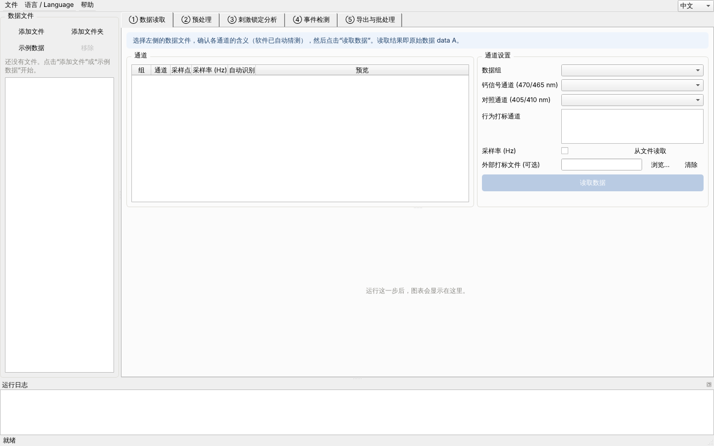
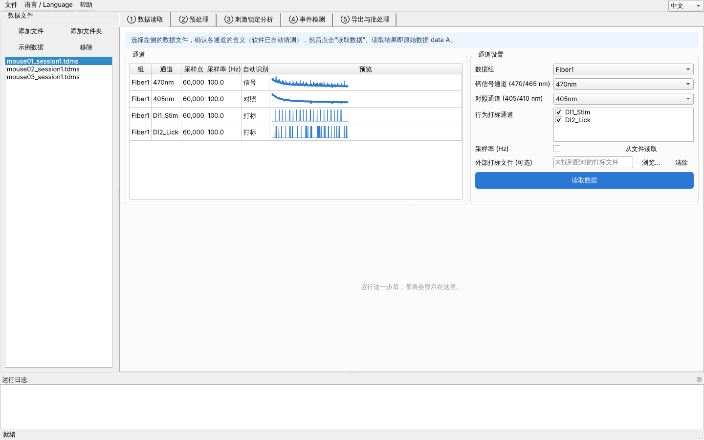
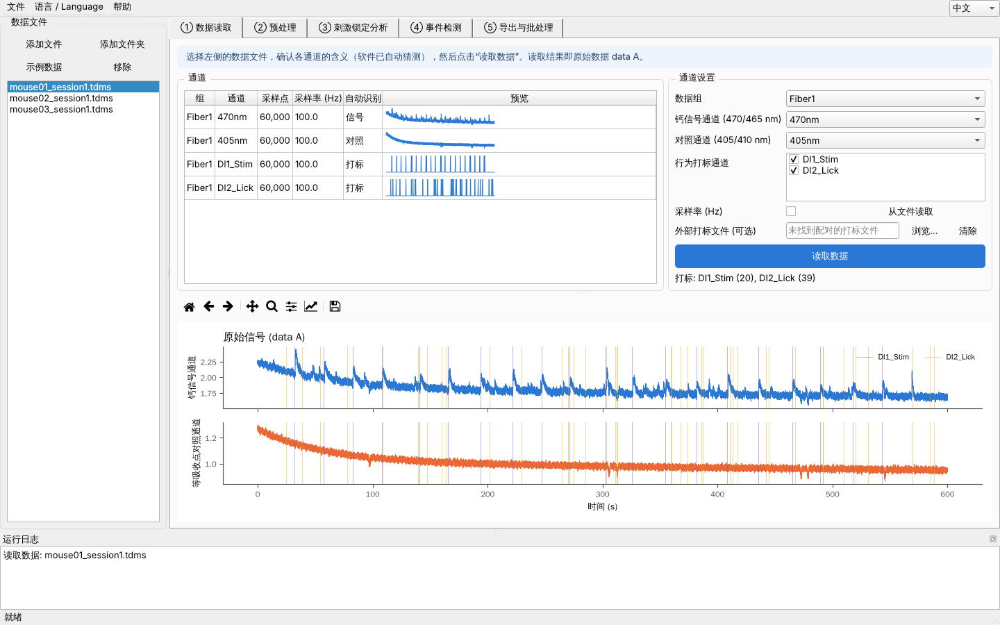
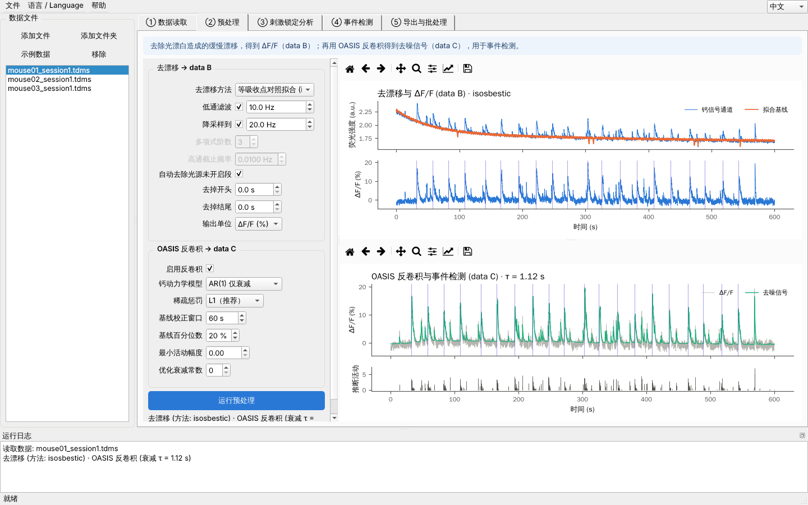
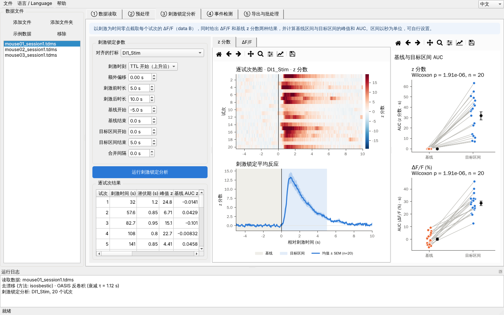
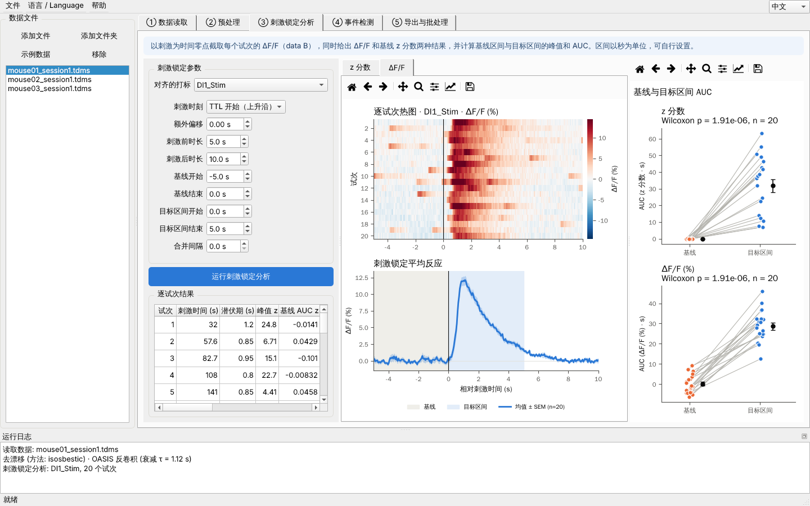
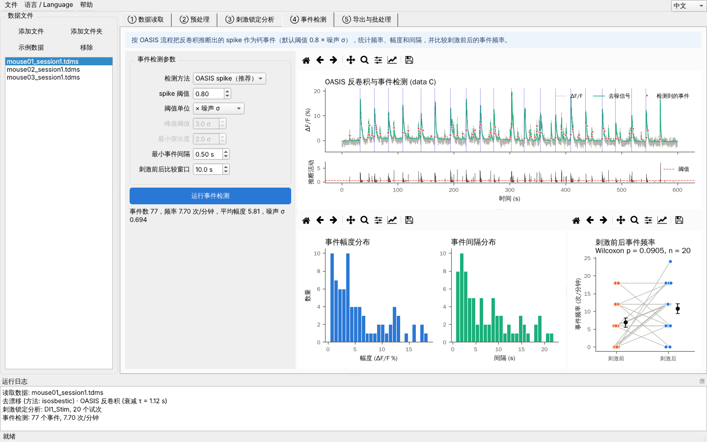
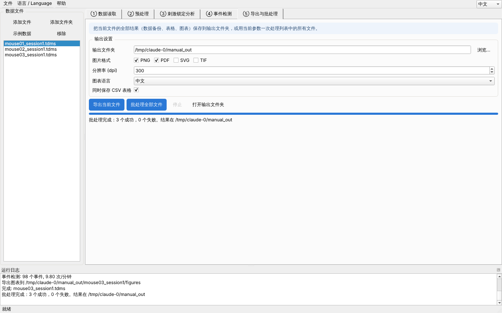

# FiberPhoto 光纤记录分析软件 · 新生操作手册

> 适用版本 0.3 · 面向没有编程基础的同学。照着本手册走一遍示例数据，大约 15 分钟就能上手。

## 目录

1. 软件能做什么
2. 安装与启动
3. 界面一览
4. 快速上手：用示例数据走一遍
5. 分析自己的数据
6. 重要参数怎么调
7. 输出文件说明
8. 常见问题

---

## 1. 软件能做什么

FiberPhoto 把实验室光纤记录（钙成像，TDMS 格式）的分析流程做成了 5 个按顺序排列的页签，每一步都能看到图、能改参数：

| 步骤 | 做什么 | 得到的数据 |
|---|---|---|
| ① 数据读取 | 读 TDMS 文件，识别钙信号通道（470/465 nm）、对照通道（405/410 nm）和行为打标（TTL） | **data A**（原始数据） |
| ② 预处理 | 去除光漂白引起的缓慢漂移，算出 ΔF/F；再用 OASIS 反卷积得到去噪信号和推断的 spike | **data B**（ΔF/F）、**data C**（反卷积结果） |
| ③ 刺激锁定分析 | 以每次刺激为零点截取试次，同时给出 z 分数、ΔF/F 和 AUC | 热图、平均曲线、AUC 配对图 |
| ④ 事件检测 | 按 OASIS 流程把 spike 作为钙事件，统计频率、幅度、间隔，比较刺激前后 | 事件表和分布图 |
| ⑤ 导出与批处理 | 保存所有数据备份、表格和图；或用同一套参数一次处理整个文件夹 | 结果文件夹 |

data B 和 data C 都会自动另存一份备份（HDF5 + CSV），以后不用重新计算。

## 2. 安装与启动

### Windows

1. 解压 `fiberphoto-windows.zip`，得到 `fiberphoto` 文件夹（**不要**直接在压缩包里运行）。
2. 双击文件夹里的 `fiberphoto.exe`。
3. 第一次打开时如果弹出“Windows 已保护你的电脑”，点击 **更多信息 → 仍要运行**。这是因为软件没有购买商业签名，并不是病毒。

### macOS

1. 解压 `fiberphoto-macos.zip`，把 `fiberphoto.app` 拖进“应用程序”文件夹。
2. 第一次打开：在“应用程序”里**右键（或按住 Control 点按）fiberphoto → 打开 → 打开**。
3. 如果提示“已损坏，无法打开”，打开“终端”，输入下面这行后回车，再重新打开：
   `xattr -cr /Applications/fiberphoto.app`

> 软件启动需要几秒钟，请耐心等待，不要重复双击。

## 3. 界面一览

- **左侧“数据文件”**：添加文件、添加文件夹、加载示例数据、移除。点击列表中的文件即可切换当前分析的记录。
- **中间 5 个页签**：从左到右就是分析顺序。每个页签顶部的蓝色说明条会告诉你这一步在做什么。
- **参数框**：鼠标停在任何参数上会弹出中文解释。参数是所有文件共用的。
- **图表工具栏**：🏠 复原、✥ 平移、🔍 放大、💾 保存当前图。
- **底部“运行日志”**：每一步做了什么、有没有警告，都写在这里。遇到问题时请截图日志发给师兄师姐。
- **右上角语言切换**：中文 / English 随时切换，导出的图也会跟着切换语言。
- **“文件”菜单**：保存参数 / 载入参数 / 恢复默认参数。建议每个实验保存一份参数文件，写论文时方便核对。

## 4. 快速上手：用示例数据走一遍

示例数据是软件模拟出的 3 只小鼠（mouse01–03），每只 10 分钟，20 次刺激，反应强度从强到弱。模拟时已知“正确答案”，适合用来熟悉软件。

### 第 1 步：加载示例数据

点击左侧 **示例数据**。软件会在“文稿/Documents”下生成 `fiberphoto_sample_data` 文件夹并自动加入列表。

### 第 2 步：① 数据读取

1. 在左侧选中 `mouse01_session1.tdms`。
2. 左上方表格列出了文件里所有通道，**“预览”列的缩略图**可以帮你判断每个通道是什么：钙信号会有很多小峰，对照通道比较平滑，打标通道是一根根方波。
3. 右侧“通道设置”里，软件已经自动猜好了钙信号、对照和打标通道。确认无误后点击 **读取数据**。

下方图中蓝线是钙信号，橙线是对照通道，竖线是打标时刻。读取成功后，“打标：DI1_Stim (20) …”会显示每个打标通道找到了多少次。

### 第 3 步：② 预处理

切到 **② 预处理**，直接点击 **运行预处理**（默认参数即可）。

- 右上图：上半部分是钙信号和拟合出的基线（橙色），下半部分是去漂移后的 ΔF/F（data B）。漂移被去掉后，曲线应该大致是平的。
- 右下图：灰色是 ΔF/F，绿色是 OASIS 去噪信号，下方小图是推断的 spike（data C）。标题里的 τ 是钙信号衰减时间常数，GCaMP6s 一般在 0.5–2 s。

### 第 4 步：③ 刺激锁定分析

切到 **③ 刺激锁定分析**，点击 **运行刺激锁定分析**。

- **热图**：每一行是一个试次，0 s（黑竖线）是刺激时刻。
- **平均曲线**：灰色阴影是**基线区间**，浅蓝阴影是**目标区间**，蓝线和阴影是均值 ± SEM。
- **右侧 AUC 配对图**：每条灰线连接同一试次的基线 AUC 和目标区间 AUC，上方是配对检验的 p 值。上面一幅是 z 分数，下面一幅是 ΔF/F。
- **逐试次结果表**：每个试次的潜伏期、峰值、AUC 等，可以左右拖动查看。

点击图上方的 **ΔF/F** 小页签，可以看同样的分析用 ΔF/F 表示的结果：

### 第 5 步：④ 事件检测

切到 **④ 事件检测**，点击 **运行事件检测**。

- 上图红色三角是检测到的事件；下方小图的红色虚线是 spike 阈值（默认 0.8 × 噪声 σ）。
- 下方三幅图：事件幅度分布、事件间隔分布、刺激前后事件频率比较。
- 左侧会显示事件数、频率（次/分钟）、平均幅度和噪声 σ。

### 第 6 步：⑤ 导出与批处理

切到 **⑤ 导出与批处理**：

1. 选择 **输出文件夹**。
2. 勾选图片格式（PNG 适合做 PPT，PDF/SVG 适合在 Illustrator 里修改），分辨率默认 300 dpi。
3. 点击 **导出当前文件** 只保存当前文件；点击 **批处理全部文件** 会用当前参数依次处理列表里的所有文件。
4. 完成后点击 **打开输出文件夹** 查看结果。

> 恭喜！到这里你已经完成了一次完整分析。可以试着换到 mouse03（反应最弱），看看结果有什么不同。

## 5. 分析自己的数据

### 5.1 准备文件

- 把一次实验的所有 `.tdms` 文件放在同一个文件夹里。
- 如果打标单独保存成了 `xxx-Event.tdms`，请让它和主文件**同名、在同一文件夹**，例如 `mouse01.tdms` 和 `mouse01-Event.tdms`。软件会自动配对，不需要手动选择；列表里也不会把 Event 文件当成独立记录。
- 打标也可以是 CSV / Excel 表格：在“外部打标文件”中点击 **浏览…** 选择。表格每行是一次打标：`onset` 列为开始时间（秒），可选 `offset` 列为结束时间，可选 `label` 列为打标名称（如 tone、shock）。列名也可以写“开始 / 结束 / 标签”。
- 文件路径里尽量不要有特殊符号。中文路径可以用。

### 5.2 读取时要检查的 3 件事

1. **采样率**：我们实验室的光纤记录采样率是 **50 Hz**。如果文件没有记录采样率，软件会出现橙色提示“这个文件没有记录采样率”，请在 **采样率 (Hz)** 框中填写 `50`。框中显示“从文件读取”表示使用文件里记录的采样率。
2. **通道是否选对**：用“预览”缩略图核对钙信号和对照通道。如果软件猜错了，在右侧下拉框里改过来。
3. **打标数量是否正确**：读取后看“打标：…(n)”中的次数是否等于实际给刺激的次数。

### 5.3 电击实验：对齐到 TTL 结束

电击控制软件会先发出一个持续 **1 s** 的 TTL，**TTL 结束后**才给电击。所以在 ③ 刺激锁定分析中：

- **刺激时刻** 选择 **TTL 结束（下降沿）**；
- **额外偏移** 保持 0。

如果是声音、光刺激等和 TTL 同时出现的刺激，选 **TTL 开始（上升沿）**。

### 5.4 光源未开启的开头

很多记录开头几秒 LED 还没打开，信号接近 0。默认勾选的 **自动去除光源未开启段** 会自动把这一段去掉，并在日志中提示。如果你还想多去掉一些（例如开头不稳定的 1 分钟），在 **去掉开头 / 去掉结尾** 里填秒数。

### 5.5 预处理时的警告

日志里如果出现以 ⚠ 开头的警告（例如“基线荧光为零或负值”“没有对照通道”），说明这段数据可能有问题：通道选错、对照通道没接好、光纤松动等。“光源未开启，已自动去除”只是提示，不必担心。请先看 ① 中的原始图，再和师兄师姐讨论是否保留这只动物。

## 6. 重要参数怎么调

所有参数都有悬停提示。下面是最常改的几个，**其余保持默认即可**。

### 预处理

| 参数 | 默认 | 说明 |
|---|---|---|
| 去漂移方法 | 等吸收点对照拟合 | 用 405 nm 对照通道拟合并扣除漂移和运动伪迹。没有对照通道时，软件会自动改用双指数拟合。 |
| 低通滤波 | 10 Hz | 去掉高频噪声，只影响 data B 的显示和刺激锁定分析。 |
| 降采样到 | 20 Hz | 减小文件大小。50 Hz 数据降到 20 Hz 不影响钙信号。 |
| 输出单位 | ΔF/F (%) | 一般不需要改。 |
| 钙动力学模型 | AR(1) | GCaMP 上升很快时用 AR(1)；上升较慢（如 GCaMP6s 高采样率）可以试 AR(2)。 |

反卷积使用的是**去漂移后的 ΔF/F（data B，未低通）**，不是原始数据。

### 刺激锁定分析

| 参数 | 默认 | 说明 |
|---|---|---|
| 刺激时刻 | TTL 开始 | 电击实验改为 **TTL 结束**（见 5.3）。 |
| 刺激前 / 后时长 | 5 s / 10 s | 每个试次截取的范围，决定热图的横轴。 |
| 基线开始 / 结束 | −5 s / 0 s | 用于计算 z 分数和基线 AUC 的区间。 |
| 目标区间开始 / 结束 | 0 s / 5 s | 计算目标区间 AUC 和峰值的区间。 |
| 合并间隔 | 0 s | 两次打标间隔小于这个值时只算第一次（用于去掉重复打标）。 |

所有时间单位都是秒，相对于刺激时刻，刺激前为负数。

**z 分数**：每个试次用自己的基线区间均值和标准差标准化，所以基线 z ≈ 0。**ΔF/F** 则直接使用 data B 的数值。**AUC** 用梯形法计算，单位是“值 × 秒”。

### 事件检测

| 参数 | 默认 | 说明 |
|---|---|---|
| 检测方法 | OASIS spike | 按 OASIS 流程，把推断出的 spike 作为钙事件。 |
| spike 阈值 | 0.80 | 和“阈值单位”一起使用。 |
| 阈值单位 | × 噪声 σ | spike ≥ 0.8 × 噪声标准差时记为一次事件。阈值调高 → 事件更少、更可靠；调低 → 更敏感，但假阳性更多。 |
| 最小事件间隔 | 0.5 s | 间隔更近的 spike 合并为同一个事件。 |
| 刺激前后比较窗口 | 10 s | 比较每次刺激前、后各 10 s 内的事件频率。 |

> **同一个实验的所有动物必须使用相同参数。** 改完参数后请在“文件 → 保存参数”存一份，批处理时载入同一份参数。

## 7. 输出文件说明

每个记录在输出文件夹里有一个同名子文件夹：

| 文件 | 内容 |
|---|---|
| `<名称>.h5` | data A / B / C 的完整备份（HDF5），可用 Python/MATLAB 读取 |
| `<名称>_dataA.csv` / `_dataB.csv` / `_dataC.csv` | 同上，表格格式，可直接用 Excel 打开 |
| `peth_trials_z.csv` / `peth_trials_dff.csv` | 每个试次的 z 分数 / ΔF/F 曲线（行 = 试次，列 = 时间） |
| `peth_metrics.csv` | 每个试次的潜伏期、基线/目标区间均值、峰值、AUC（z 和 ΔF/F 各一套） |
| `events.csv` | 每个事件的时间、幅度、spike 总和、最大 spike、事件间隔 |
| `events_vs_stimulus.csv` | 每次刺激前后的事件数和频率 |
| `summary.json` | 本记录的汇总指标 |
| `parameters.json` | 本次使用的全部参数（可在软件中“载入参数”复现） |
| `figures/` | 01 原始信号、02 去漂移、03 反卷积与事件、04 热图（z / ΔF/F）、05 AUC、06 事件分布、07 刺激前后事件频率 |

批处理时，输出文件夹根目录还有一个 `batch_summary.csv`，每只动物一行，方便直接做组间统计。

## 8. 常见问题

**Q：点击“读取数据”后提示需要填写采样率？**
A：这个文件没有记录采样率。在 ① 的“采样率 (Hz)”中填 50 后再读取。

**Q：打标次数是 0 或者不对？**
A：先看“预览”列中打标通道是不是方波。如果打标存在单独的 `-Event.tdms` 文件中，确认它和主文件同名、在同一文件夹。也可以手动在“外部打标文件”中选择。

**Q：ΔF/F 曲线整体倾斜或有大的跳变？**
A：可能是光纤松动或对照通道异常。可以在“去漂移方法”中试试“双指数拟合”，并比较结果。如果跳变只在开头或结尾，用“去掉开头 / 去掉结尾”去掉。

**Q：事件太多 / 太少？**
A：调整“spike 阈值”。先在示例数据上体会阈值的影响，再决定自己数据用什么值，并且所有动物保持一致。

**Q：刺激锁定分析提示没有打标？**
A：检查“对齐的打标”下拉框是否选了正确的打标通道。

**Q：图里的中文显示成方框？**
A：在 ⑤ 中把“图表语言”改成 English，或联系维护者。

**Q：软件卡住不动？**
A：长文件计算需要时间，进度条和日志会更新。如需中断，在 ⑤ 中点击“停止”。如果确实没有反应，关闭软件重开，并把日志截图发给维护者。

**Q：我想换一台电脑继续分析？**
A：把输出文件夹和 `parameters.json` 一起拷走即可。h5 备份可以直接查看，不必重新计算。

---

有问题请先查看运行日志，再联系实验室的软件维护者。
