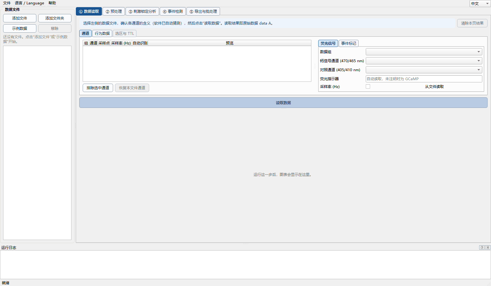
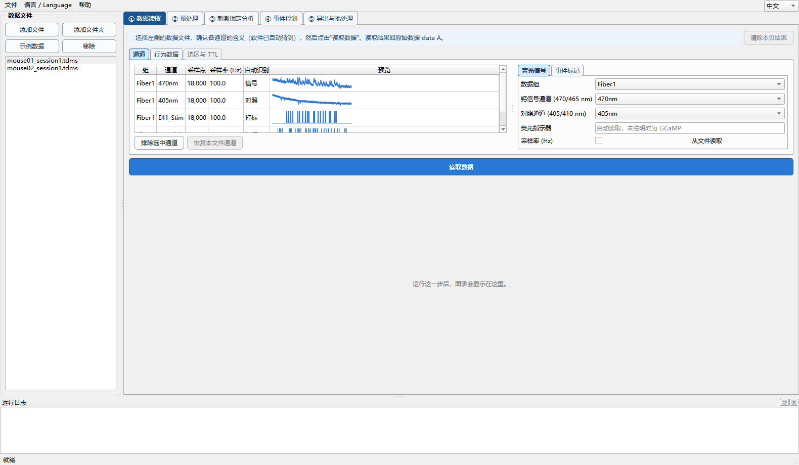
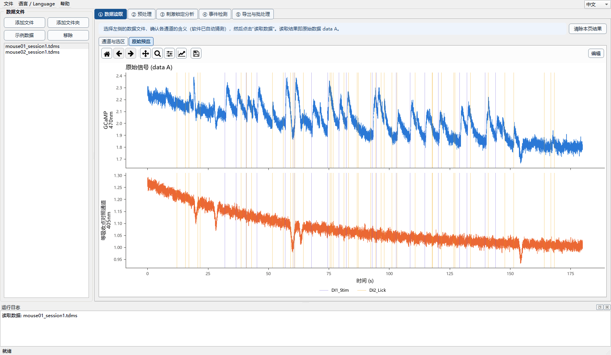
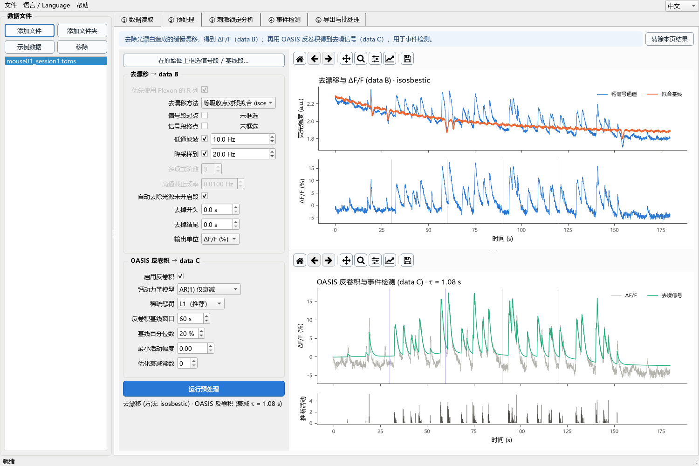
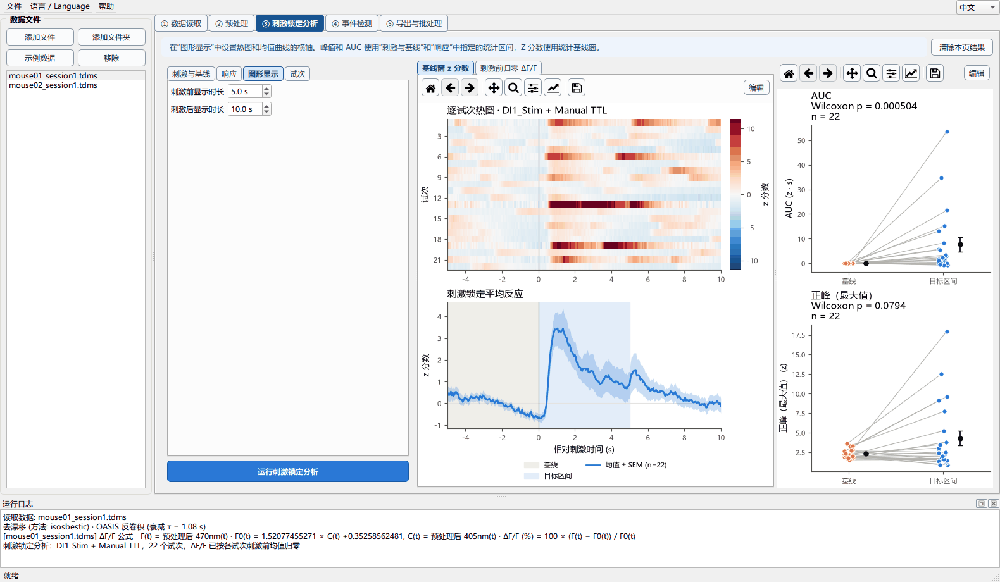
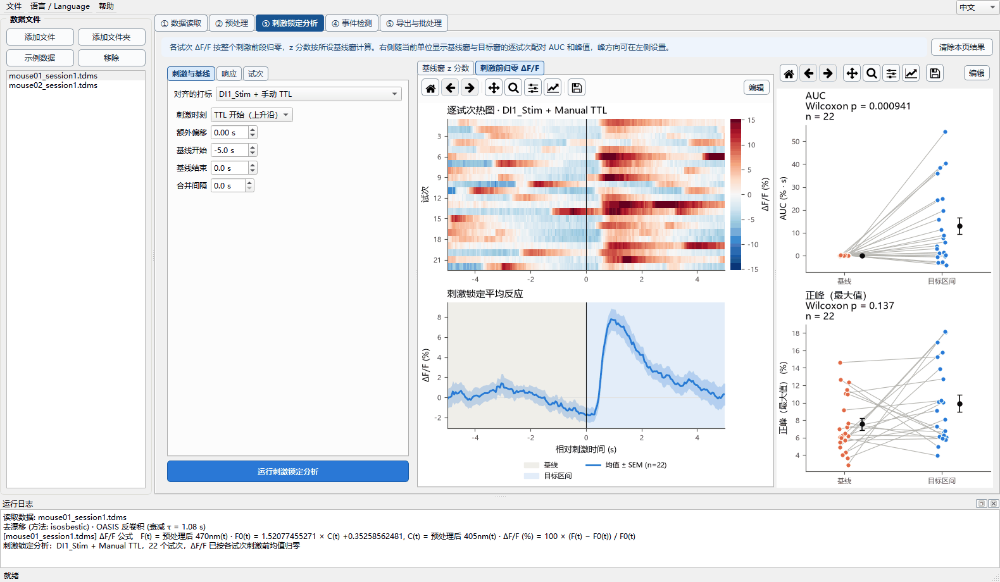
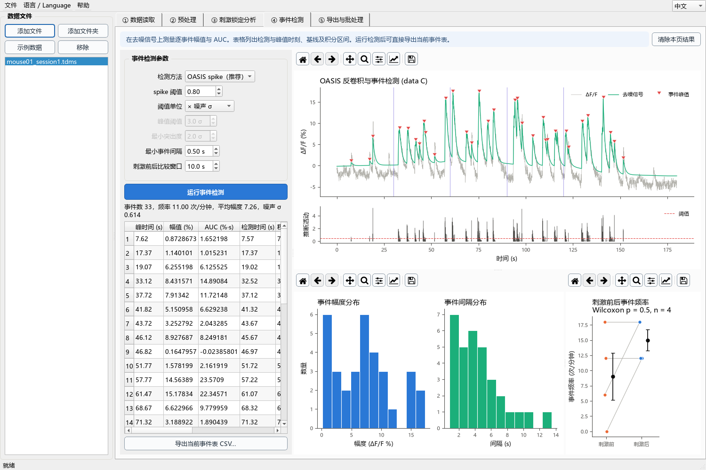
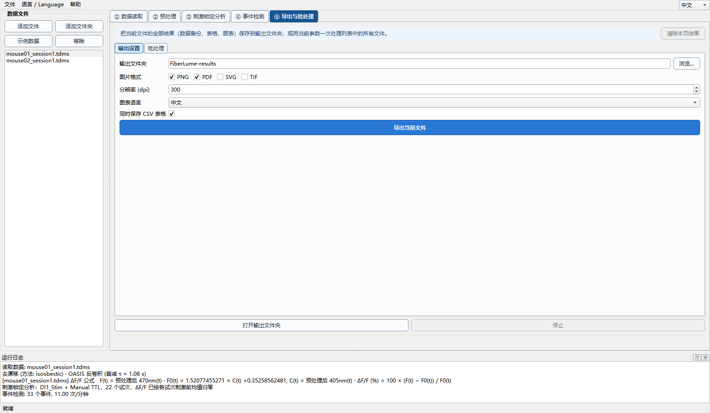

# FiberLume 光纤记录分析软件 · 新生操作手册

> 适用版本 0.6.5。示例分析约需 15 分钟。

## 目录

1. 软件能做什么
2. 安装与启动
3. 界面一览
4. 快速上手：用示例数据走一遍
5. 分析自己的数据
6. 重要参数怎么调
7. 输出文件说明
8. 常见问题

---

## 1. 软件能做什么

FiberLume 将光纤记录分析分为五个页面，可以在各页调整参数、运行相应步骤并查看结果。

| 步骤 | 做什么 | 得到的数据 |
|---|---|---|
| ① 数据读取 | 读 TDMS 文件，识别钙信号通道（470/465 nm）、对照通道（405/410 nm）和行为打标（TTL） | **data A**（原始数据） |
| ② 预处理 | 去除光漂白引起的缓慢漂移，算出 ΔF/F；再用 OASIS 反卷积得到去噪信号和推断的 spike | **data B**（ΔF/F）、**data C**（反卷积结果） |
| ③ 刺激锁定分析 | 以每次刺激为零点截取试次，比较基线窗与响应窗 | 热图、平均曲线、AUC 和峰值配对图 |
| ④ 事件检测 | 按 OASIS 流程把 spike 作为钙事件，统计频率、幅度、间隔，比较刺激前后 | 事件表和分布图 |
| ⑤ 导出与批处理 | 保存所有数据备份、表格和图；或用同一套参数一次处理整个文件夹 | 结果文件夹 |

每页都提供“清除本页结果”。例如，清除刺激锁定结果后，可修改窗口并重跑，仍可查看同一文件的事件检测结果。清除预处理时，下游的刺激锁定和事件结果一并清除。参数、原始文件和磁盘上已导出的结果保留。

## 2. 安装与启动

### Windows

双击 `FiberLume-0.6.0-Windows-Setup.exe`，按提示完成安装，从开始菜单打开 **FiberLume**。

### macOS

Apple 芯片 Mac 使用 `FiberLume-0.6.0-macOS-AppleSilicon.dmg`。打开磁盘映像，将 **FiberLume** 拖入“应用程序”并启动。

安装后，选择 **帮助 → 检查更新**，确认下载补丁并重启软件。安装包内含 Python 及分析所需的依赖。

## 3. 界面一览

- **左侧“数据文件”**：添加文件、添加文件夹、加载示例数据、移除。点击列表中的文件即可切换当前分析的记录。
- **中间 5 个页签**：从左到右就是分析顺序。每个页签顶部的蓝色说明条会告诉你这一步在做什么。
- **参数框**：鼠标停在任何参数上会弹出中文解释。参数是所有文件共用的。
- **图表工具栏**：🏠 复原、✥ 平移、🔍 放大、💾 保存当前图。
- **底部“运行日志”**：每一步做了什么、有没有警告，都写在这里。遇到问题时请截图日志发给师兄师姐。
- **右上角语言切换**：中文 / English 随时切换，导出的图也会跟着切换语言。
- **“文件”菜单**：保存参数 / 载入参数 / 恢复默认参数。建议每个实验保存一份参数文件，写论文时方便核对。

## 4. 快速上手：用示例数据走一遍

示例数据是软件模拟出的 3 只小鼠（mouse01–03），每只 10 分钟，20 次刺激，反应强度从强到弱。模拟时已知“正确答案”，适合用来熟悉软件。

### 第 1 步：加载示例数据

点击左侧 **示例数据**。软件会在“文稿/Documents”下生成 `fiberphoto_sample_data` 文件夹并自动加入列表。

### 第 2 步：① 数据读取

1. 在左侧选中 `mouse01_session1.tdms`。
2. 左上方表格列出了文件里所有通道，**“预览”列的缩略图**可以帮你判断每个通道是什么：钙信号会有很多小峰，对照通道比较平滑，打标通道是一根根方波。
3. 右侧“通道设置”里，软件已经自动猜好了钙信号、对照和打标通道。确认无误后点击 **读取数据**。

下方图中蓝线是钙信号，橙线是对照通道，竖线是打标时刻。读取成功后，“打标：DI1_Stim (20) …”会显示每个打标通道找到了多少次。

要补充已知刺激时刻，点击 **添加 TTL 事件点**，再在波形预览上单击。每个点吸附到最近采样帧，可连续标记或逐个撤销。按 Esc 退出。在刺激锁定页选择 **Manual TTL** 即可对齐这些时刻。保存参数可保留本记录的手动标记。

### 第 3 步：② 预处理

切到 **② 预处理**，直接点击 **运行预处理**（默认参数即可）。

- 右上图显示钙信号、基线和 data B。读取 Plexon 文件且当前信号有配对 R 列时，可勾选使用设备比值，或取消勾选并从原始荧光重算。其他设备的记录使用各自的预处理设置。
- 右下图：灰色是 ΔF/F，绿色是 OASIS 去噪信号，下方小图是推断的 spike（data C）。标题里的 τ 是钙信号衰减时间常数，GCaMP6s 一般在 0.5–2 s。

### 第 4 步：③ 刺激锁定分析

切到 **③ 刺激锁定分析**，点击 **运行刺激锁定分析**。

- **热图**：每一行是一个试次，0 s（黑竖线）是刺激时刻。
- **平均曲线**：灰色阴影是**基线区间**，浅蓝阴影是**目标区间**，蓝线和阴影是均值 ± SEM。
- **右侧配对比较**同时显示基线窗与响应窗的 AUC 和峰值。每条连线代表同一个试次，单位随左侧选中的 Z 或 ΔF/F 视图变化。正峰取各窗最大值，负峰取各窗最小值并保留符号。响应潜伏期为所选方向极值首次出现的相对时间。
- **逐试次结果表**：每个试次的潜伏期、峰值、AUC 等，可以左右拖动查看。

点击图上方的 **ΔF/F** 小页签，可以看同样的分析用 ΔF/F 表示的结果：

### 第 5 步：④ 事件检测

切到 **④ 事件检测**，点击 **运行事件检测**。

- 上图红色三角是检测到的事件；下方小图的红色虚线是 spike 阈值（默认 0.8 × 噪声 σ）。
- 下方三幅图：事件幅度分布、事件间隔分布、刺激前后事件频率比较。
- 左侧逐事件表显示峰时间、幅值、AUC、检测时间、积分起止和基线。点击 **导出当前事件表 CSV** 可保存这次运行的结果。幅值取去噪峰相对事件基线的高度。AUC 对去噪信号扣除该基线后按实际时间做梯形积分，保留符号，单位为 ΔF/F 单位 × 秒。

### 第 6 步：⑤ 导出与批处理

切到 **⑤ 导出与批处理**：

1. 选择 **输出文件夹**。
2. 勾选图片格式（PNG 适合做 PPT，PDF/SVG 适合在 Illustrator 里修改），分辨率默认 300 dpi。
3. 点击 **导出当前文件** 只保存当前文件；点击 **批处理全部文件** 会用当前参数依次处理列表里的所有文件。
4. 完成后点击 **打开输出文件夹** 查看结果。

> 恭喜！到这里你已经完成了一次完整分析。可以试着换到 mouse03（反应最弱），看看结果有什么不同。

## 5. 分析自己的数据

### 5.1 准备文件

- 把一次实验的所有 `.tdms` 文件放在同一个文件夹里。
- 如果打标单独保存成了 `xxx-Event.tdms`，请让它和主文件**同名、在同一文件夹**，例如 `mouse01.tdms` 和 `mouse01-Event.tdms`。软件会自动配对，不需要手动选择；列表里也不会把 Event 文件当成独立记录。
- 打标也可以是 CSV / Excel 表格：在“外部打标文件”中点击 **浏览…** 选择。表格每行是一次打标：`onset` 列为开始时间（秒），可选 `offset` 列为结束时间，可选 `label` 列为打标名称（如 tone、shock）。列名也可以写“开始 / 结束 / 标签”。
- 文件路径里尽量不要有特殊符号。中文路径可以用。

#### ABET 声音与食槽任务

把每个会话的钙记录与同名 ABET XML 放在一起。例如，`mouse01.csv` 配 `mouse01.xml`。在数据读取页打开 ABET XML，先核对试次、声音、食槽灯、有效进槽和给食器指令。每次进槽的传感器上升沿都可记录，只有响应窗口内被程序接受的进槽才计为有效响应。给食指令记录设备动作，实际摄取时间需独立观测。

同步按会话配置。若有 Plexon 端实测时间，用对应的一个上升沿估计时间偏移，两个上升沿可同时估计时钟速率差。若只知道 ABET 的首个 `start #1` 自动启动采集，可明确选择假定触发模式。若假定首帧比触发晚 L 秒，行为事件在钙轴上的时间等于首帧时间加上事件相对行为开始脉冲的时间，再减去 L。默认假定 L 为零。首末帧跨度与首末脉冲跨度之差同时受停录延迟和时钟速率影响，无法单独求出本次启动延迟。保留“仅行为”可以先导出试次，之后再补同步信息。

预处理后，在刺激锁定页点击 **比较 ABET 声音与进槽分组**。常规声音试次按后续有效响应或超时分组，声灯同开的特殊试次单列。每次取事件前 3 秒均值作为零点，在 0 至 3 秒计算平均值、带符号 AUC 及所选方向的峰值。进槽比较使用有效进槽与给食指令组成的事件，以及远离任务事件的独立窗外进槽。逐试次表保留行为与钙时钟及排除原因。图和组均值描述当前会话，跨动物汇总时应保留动物和会话层级。

批量导出时可逐份设置或载入同步清单。每个会话的 `abet` 目录保存试次和时钟映射，已映射的记录还会生成 `locked` 中的逐事件指标、时间曲线和组汇总。检查同步方式后再合并不同会话。

在 **⑤ 导出与批处理 → 导出清单模板** 生成 CSV，每行对应一份钙记录（`recording`），可选 `xml` 为同一会话的行为文件。模板会带入已有设置。按实际依据填写 `mode`，再在同一页选择清单并运行批处理。

| mode | 填写的时钟信息 |
|---|---|
| `behavior_only` | 仅行为，保留设备原始时间 |
| `assumed_trigger` | `latency_s` 为假定的启动延迟，未知时填 0，结果标为估算 |
| `offset` | `abet_1_s` 和 `calcium_1_s` 为同一实测事件在两台设备上的秒数 |
| `affine` | 再填第二对 `abet_2_s` 和 `calcium_2_s`，两对按时间先后排列 |
| `disabled` | 跳过此记录的 ABET 分析 |

总目录中的 `batch_abet_groups.csv` 保留每个会话各组的纳入数、时钟模式、ΔF/F 单位和均值。

在 `batch_summary.csv` 可逐个核对钙记录跨度、行为首末脉冲间隔和二者之差。若有实测锚点并恰好记录了两个边界脉冲，`abet_first_frame_minus_mapped_start_s` 表示首帧减去映射后的开始脉冲时间。正数表示首帧较晚。相应的 `abet_last_frame_minus_mapped_end_s` 表示末帧相对结束脉冲的时间差。仅行为和假定触发模式下这两个值留空。

### 5.2 读取时要检查的 3 件事

1. **采样率**：我们实验室的光纤记录采样率是 **50 Hz**。如果文件没有记录采样率，软件会出现橙色提示“这个文件没有记录采样率”，请在 **采样率 (Hz)** 框中填写 `50`。框中显示“从文件读取”表示使用文件里记录的采样率。
2. **通道是否选对**：用“预览”缩略图核对钙信号和对照通道。如果软件猜错了，在右侧下拉框里改过来。
3. **打标数量是否正确**：读取后看“打标：…(n)”中的次数是否等于实际给刺激的次数。

### 5.3 电击实验：对齐到 TTL 结束

电击控制软件会先发出一个持续 **1 s** 的 TTL，**TTL 结束后**才给电击。所以在 ③ 刺激锁定分析中：

- **刺激时刻** 选择 **TTL 结束（下降沿）**；
- **额外偏移** 保持 0。

如果是声音、光刺激等和 TTL 同时出现的刺激，选 **TTL 开始（上升沿）**。

### 5.4 光源未开启的开头

很多记录开头几秒 LED 还没打开，信号接近 0。默认勾选的 **自动去除光源未开启段** 会自动把这一段去掉，并在日志中提示。如果你还想多去掉一些（例如开头不稳定的 1 分钟），在 **去掉开头 / 去掉结尾** 里填秒数。

### 5.5 预处理时的警告

日志里如果出现以 ⚠ 开头的警告（例如“基线荧光为零或负值”“没有对照通道”），说明这段数据可能有问题：通道选错、对照通道没接好、光纤松动等。“光源未开启，已自动去除”只是提示，不必担心。请先看 ① 中的原始图，再和师兄师姐讨论是否保留这只动物。

## 6. 重要参数怎么调

所有参数都有悬停提示。下面是最常改的几个，**其余保持默认即可**。

### 预处理

| 参数 | 默认 | 说明 |
|---|---|---|
| 去漂移方法 | 等吸收点对照拟合 | 用 405 nm 对照通道拟合并扣除漂移和运动伪迹。没有对照通道时，软件会自动改用双指数拟合。 |
| 低通滤波 | 10 Hz | 去掉高频噪声，只影响 data B 的显示和刺激锁定分析。 |
| 降采样到 | 20 Hz | 减小文件大小。50 Hz 数据降到 20 Hz 不影响钙信号。 |
| 输出单位 | ΔF/F (%) | 重新计算时的单位。Plexon 的 R 列直读保留设备比值。 |
| 钙动力学模型 | AR(1) | GCaMP 上升很快时用 AR(1)；上升较慢（如 GCaMP6s 高采样率）可以试 AR(2)。 |

反卷积使用的是**去漂移后的 ΔF/F（data B，未低通）**，不是原始数据。

### 刺激锁定分析

| 参数 | 默认 | 说明 |
|---|---|---|
| 刺激时刻 | TTL 开始 | 电击实验改为 **TTL 结束**（见 5.3）。 |
| 刺激前 / 后时长 | 5 s / 10 s | 每个试次截取的范围，决定热图的横轴。 |
| 基线开始 / 结束 | −5 s / 0 s | 用于计算 z 分数和基线 AUC。ΔF/F 的归零区间由整个刺激前时长决定。 |
| 目标区间开始 / 结束 | 0 s / 5 s | 计算目标区间 AUC 和峰值的区间。 |
| 峰值方向 | 正峰 | 钙信号升高时选正峰，降低时选负峰。用相同方向比较两个窗口，并记录响应峰潜伏期。 |
| 合并间隔 | 0 s | 两次打标间隔小于这个值时只算第一次（用于去掉重复打标）。 |

所有时间单位都是秒，相对于刺激时刻，刺激前为负数。

每个试次分别计算 **归零 ΔF/F**。设该试次刺激前全部样本（t < 0）的均值为 m，则试次曲线为 ΔF/F(t) − m，单位沿用 data B。刺激时刻的样本不参与求均值。热图、均值曲线、ΔF/F 峰值和 AUC 都使用归零曲线。每个试次减去的 m 可在 `peth_metrics.csv` 的 `prestimulus_mean_input_dff` 列查看。Z 分数使用所设基线窗的均值和样本标准差，AUC 使用梯形积分。

### 事件检测

| 参数 | 默认 | 说明 |
|---|---|---|
| 检测方法 | OASIS spike | 按 OASIS 流程，把推断出的 spike 作为钙事件。 |
| spike 阈值 | 0.80 | 和“阈值单位”一起使用。 |
| 阈值单位 | × 噪声 σ | spike ≥ 0.8 × 噪声标准差时记为一次事件。阈值调高 → 事件更少、更可靠；调低 → 更敏感，但假阳性更多。 |
| 最小事件间隔 | 0.5 s | 间隔更近的 spike 合并为同一个事件。 |
| 刺激前后比较窗口 | 10 s | 比较每次刺激前、后各 10 s 内的事件频率。 |

> **同一个实验的所有动物必须使用相同参数。** 改完参数后请在“文件 → 保存参数”存一份，批处理时载入同一份参数。

## 7. 输出文件说明

每个记录在输出文件夹里有一个同名子文件夹：

| 文件 | 内容 |
|---|---|
| `<名称>.h5` | data A / B / C 的完整备份（HDF5），可用 Python/MATLAB 读取 |
| `<名称>_dataA.csv` / `_dataB.csv` / `_dataC.csv` | 同上，表格格式，可直接用 Excel 打开 |
| `peth_trials_z.csv` / `peth_trials_dff.csv` | 每个试次的 z 分数 / 刺激前归零 ΔF/F 曲线。每行一个相对时刻，每列一个试次，另附均值和 SEM。 |
| `peth_metrics.csv` | 每个试次的潜伏期、基线/目标区间均值、峰值、AUC（z 和 ΔF/F 各一套） |
| `events.csv` | 每个事件的时间、幅值、AUC、积分边界、基线和单位，以及所用方法的其他检测指标。 |
| `peth_paired_stats.csv` | 基线窗与响应窗的 AUC 和峰值配对比较，包括方向、单位、有效配对数、均值和 p 值。 |
| `events_vs_stimulus.csv` | 每次刺激前后的事件数和频率 |
| `summary.json` | 本记录的汇总指标 |
| `parameters.json` | 本次使用的全部参数（可在软件中“载入参数”复现） |
| `figures/` | 01 原始信号、02 去漂移、03 反卷积与事件、04 热图（Z / ΔF/F）、05 AUC 与峰值配对比较、06 事件分布、07 刺激前后事件频率 |

批处理时，输出文件夹根目录还有一个 `batch_summary.csv`，每只动物一行，方便直接做组间统计。

## 8. 常见问题

**Q：点击“读取数据”后提示需要填写采样率？**
A：这个文件没有记录采样率。在 ① 的“采样率 (Hz)”中填 50 后再读取。

**Q：打标次数是 0 或者不对？**
A：先看“预览”列中打标通道是不是方波。如果打标存在单独的 `-Event.tdms` 文件中，确认它和主文件同名、在同一文件夹。也可以手动在“外部打标文件”中选择。

**Q：ΔF/F 曲线整体倾斜或有大的跳变？**
A：可能是光纤松动或对照通道异常。可以在“去漂移方法”中试试“双指数拟合”，并比较结果。如果跳变只在开头或结尾，用“去掉开头 / 去掉结尾”去掉。

**Q：事件太多 / 太少？**
A：调整“spike 阈值”。先在示例数据上体会阈值的影响，再决定自己数据用什么值，并且所有动物保持一致。

**Q：刺激锁定分析提示没有打标？**
A：检查“对齐的打标”下拉框是否选了正确的打标通道。

**Q：图里的中文显示成方框？**
A：在 ⑤ 中把“图表语言”改成 English，或联系维护者。

**Q：软件卡住不动？**
A：长文件计算需要时间，进度条和日志会更新。如需中断，在 ⑤ 中点击“停止”。如果确实没有反应，关闭软件重开，并把日志截图发给维护者。

**Q：我想换一台电脑继续分析？**
A：把输出文件夹和 `parameters.json` 一起拷走即可。h5 备份可以直接查看，不必重新计算。

---

有问题请先查看运行日志，再联系实验室的软件维护者。
